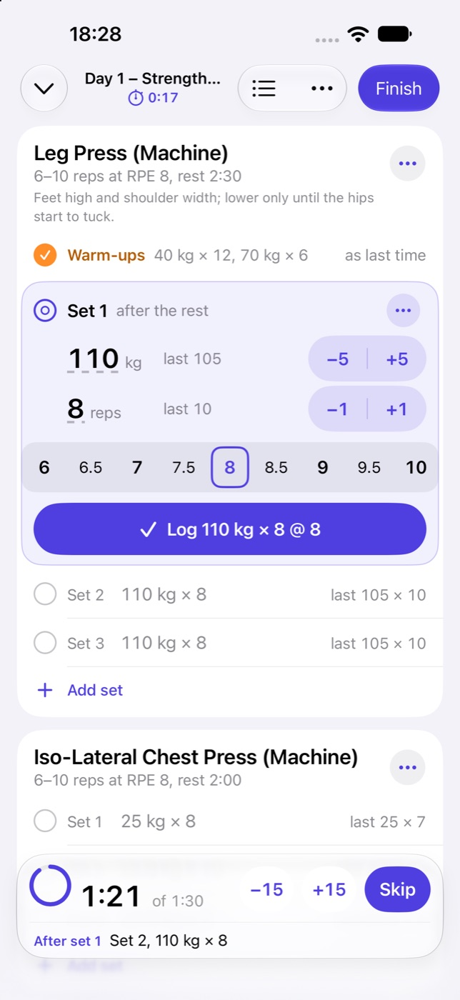
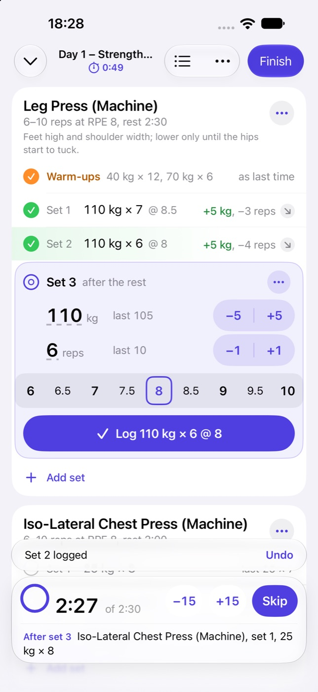
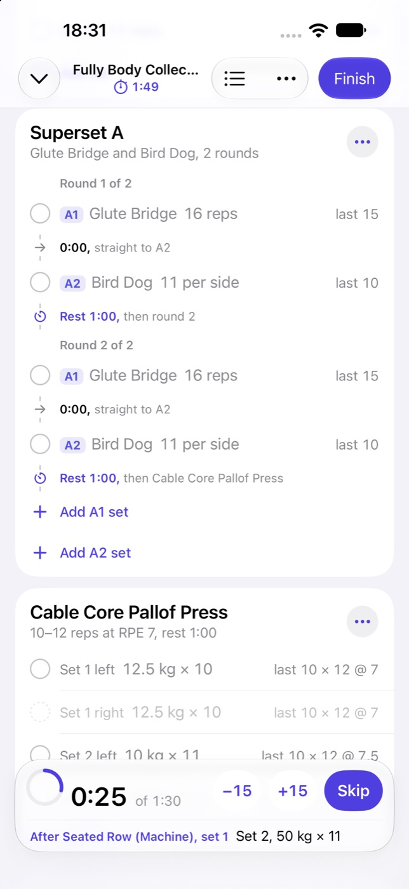
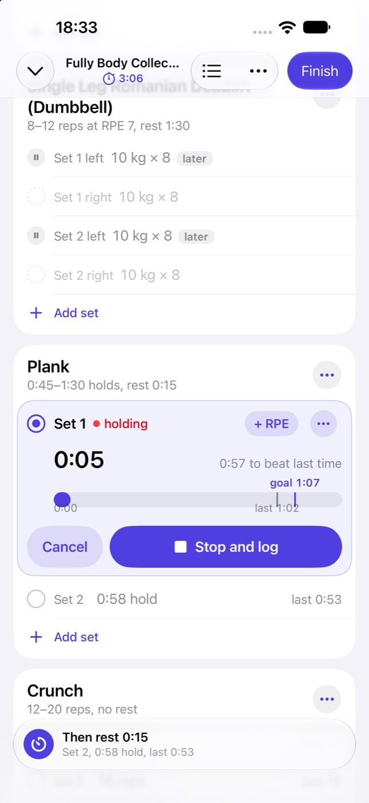

# Substrate Workouts

An iPhone app (iOS 27) for strength sessions in the gym, writing them into a
substrate as records of a training package the app keeps there. It lists the
workout routines, starts a session from one or from nothing, and runs it:
exercises in any order, supersets, warm-up, drop and myo-rep sets, timed sets,
RPE, rest timers that notify when rest ends, and a suggested load and rep
count for the next set from this session and earlier ones. Each finished
session is also saved to Apple Health as one strength workout. It came to
this repository from an app called Spotter; its spec is
[DESIGN.md](DESIGN.md), and its package is [Package/](Package/README.md).

The app has four tabs. **Routines** lists the routines by folder, previews
one and starts it (or an empty session). **History** lists finished sessions,
newest first. **Exercises** lists every exercise with its history and its
estimated 1RM trend. **Settings** holds units, rest defaults, the session
switches, alerts, Apple Health, the substrate and the update check. A session
runs in a full-screen cover whose default layout, **Rows**, shows each set as
a line, opens the set to do now in place with steppers and the planned RPE
filled in, and keeps a capsule at the bottom with the rest countdown or what
is up next; **Table** is the grid. The session's Live Activity
(`SubstrateWorkoutsWidgets`) shows the rest on the Lock Screen and in the
Dynamic Island.

```bash
mise run apple:build:workouts     # the app for the simulator
mise run apple:test:workouts      # WorkoutsKit: the model, both engines, the sync (378 tests, on the Mac)
mise run apple:release:workouts   # archived, signed and published under workouts/
uv run --with pyyaml apps/apple/scripts/workouts-package.py   # the package's manifests into the app's JSON
```

## Layout

| Path | What |
| --- | --- |
| `SubstrateWorkouts/Sources/` | the app: `App/` (the session controller, the model, `SubstrateLink`), `Platform/` (notifications, the Live Activity, HealthKit, haptics), `Shared/` (compiled into the widget too), `Views/` |
| `SubstrateWorkouts/Package/` | the training package's manifests and their long form |
| `SubstrateWorkoutsWidgets/` | the Live Activity extension |
| `WorkoutsKit/Sources/WorkoutsCore` | Foundation only: the model and its record codec, the session engine, the rest rules, the suggestion engine, the presenters, the files on the phone, the starter routines and the package's manifests |
| `WorkoutsKit/Sources/WorkoutsSync` | the app's side of a substrate, over SubstrateKit's client: the package installer, the catalogue, the outbox, the server's history, the manifest |

## Signing in and sync

Without a server the app runs on the four routines and thirty exercises it
carries and keeps every session on the phone, so it can be tried before
anyone signs in.

**Signing in** is the substrate's app authorization, through SubstrateKit
under `WorkoutsManifest`: the connect screen probes the address, the system
sheet opens the server's own sign-in and approval page, and the code comes
back to a loopback port and is exchanged with its PKCE verifier. The request
asks for:

| Asks | Why |
| --- | --- |
| `declare:~/training` | to install and upgrade the app's own package ([0203](../../../docs/decisions/0203-an-app-keeps-its-own-package-under-a-declare-scope.md)) |
| `write:~/training/*` | to read and write its exercises, routines, sessions and sets |
| `read:substrate.reamde.dev/health/workout`, `read:…/applehealth/account` | to find the Health workout a session was saved as |
| `package` detail `substrate.reamde.dev/health` | the catalogue the package requires, installed on approval |

A server whose metadata lists no `declare` verb is too old, and says so. A
release stamps its client id (`SubstrateWorkoutsClientID`, the
`workouts/client.json` the release publishes); a local build signs in as
`http://127.0.0.1/substrate-workouts`. The session is kept in the Keychain
under `dev.reamde.substrate.workouts`, and Sign Out revokes it as the kit
does for every app.

**The package is the app's.** At sign-in, at launch and on return to the
foreground, `PackageInstaller` reads
`substrate.reamde.dev/core/package/<authority>/training`:

| The repository holds | The app |
| --- | --- |
| none | applies its manifests, `~` written as the repository's authority |
| an older version | applies them again; the server lands the change at the next version |
| this version | does nothing |
| a newer version | writes nothing more, keeps sessions on the phone, and says to update the app |

A change to the package ships as the next version and is additive only: the
app's token may not confirm a lossy change. On the phone the kinds are spelled
`~/training/…`; `Rehome` swaps `~` for the repository's authority at the
server's edge, both ways, and nowhere else.

**Routines** come from the server once the package is in place, and are
cached for the gym (`catalog.json` in the repository's folder under
Application Support). A repository without any shows **Add the Starter
Routines**, which writes the carried exercises, then the routines that name
them.

**A finished session goes through the outbox** (`outbox.json`), kept on the
phone until the server takes it, in the package's order:

1. the session `PUT` at its UUIDv7, without `status`, so a replay never moves
   a finished session back;
2. each set `PUT`, a chain's head before its drops or mini-sets
   (`set.session` and `set.continues` are `mustExist`);
3. Finish as a `PATCH` under `ifVersion` (the version the create answered)
   with `status: finished`, the end, the session RPE and the plan snapshot,
   raising `revision`;
4. the Health link, `healthKitWorkout` under `ifVersion`, a revision higher.

A `409` reads the record and sends the patch again on top. A `422` naming a
revision below the stored one means a newer write landed: the entry is
dropped. No network, a busy server or a refused token stop the run with
nothing lost; any other refusal waits with the server's words and holds back
the rest of its session. Deleting a session in History drops what waits for
it and purges the server's copy.

**History** is the phone's and the server's: at each sync the finished
sessions the server holds and the phone lacks join the local history, which
PREVIOUS and the suggestions read, and the sessions and exercises the phone
has that the server lacks (logged before signing in) are queued. Nothing is
ever written to `substrate.reamde.dev/health/workout`; the Apple Health save
works as it always did.

## Tests

`mise run apple:test:workouts` runs both suites on the Mac: WorkoutsCore's
356 (the codec, the engine, the suggestions against their vectors, the
presenters, the stores) and WorkoutsSync's 22: the codec against answers
recorded from a server built from this tree (`Tests/WorkoutsSyncTests/Fixtures`),
the outbox's order and its answers to `409`, `422`, `401` and the network, the
package installer, the rehoming, and the sign-in request and status.

`LiveServerTests` runs the whole path against a real substrate when told
where: the authorization request, approved through the approval API (which
installs health), the package declared, the starter routines copied, a
finished session and its 20 sets written through the outbox, and all of it
read back as the owner.

```bash
WORKOUTS_E2E_SERVER=http://localhost:8080 WORKOUTS_E2E_OWNER_TOKEN=… WORKOUTS_E2E_REPOSITORY=<fresh repository> \
  swift test --package-path apps/apple/WorkoutsKit --filter LiveServer
```

## Screenshots

[docs/screenshots/](docs/screenshots/) holds the session's Rows layout as the
app's first build drew it, on an iPhone 18 Pro Max simulator (iOS 27), with
example sessions loaded as history: the session code moved unchanged, so this
is what it looks like here. The signed-in screens (the approval, routines from
a server, the Substrate section) are still to be added.

| Set to do now | Resting | Superset | Plank |
| --- | --- | --- | --- |
|  |  |  |  |
