# D. Chips

Status: not chosen (the owner picked Rows, 2026-10-31).

A static mockup from the second design round, 2026-10-31, drawn at iPhone Pro Max size
with the owner's real Day 1 plan. The round's brief is in [../README.md](../README.md#the-second-round).

Each exercise is a card with its sets as a row of chips (W, 1, 2, 3), with last time printed under each chip. A drawer under the chip you are on holds the RPE values, steppers for weight and reps, and Log. After each Log it moves to the next chip.

- **Good at:** The most sets on screen at once, and drop sets and myo-reps read naturally as joined chips.
- **Watch for:** A superset round is two boxes side by side, and a long exercise fills the chip row quickly.

## Screens

### 1. Leg press, set 2 ready to edit

The drawer is already open on the set to do now, so editing takes no tap to start. Done warm-ups fold into one W ×2 chip. Under set 2 is last time (105 × 10); under done set 1 is how today compares (+5 kg, one rep fewer). RPE starts on the target, 8, and the Log button says so.

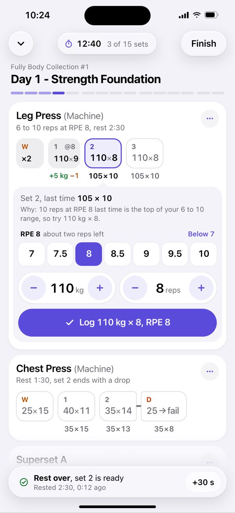

### 2. One tap later: reps +1

The chip above changes with the drawer (110 × 9, the dot means changed from the suggestion). The Log button repeats exactly what will be saved, RPE included. One more tap logs it.

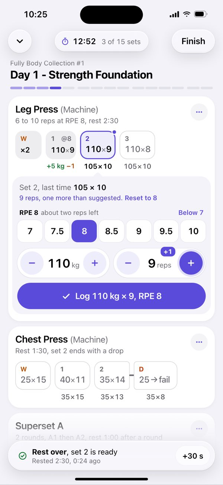

### 3. Superset, mid-round

Each round is one strip read left to right: A1, 0:00, A2, then the 1:00 round rest, then round 2. The drawer opens under the strip it edits. Finished exercises above fold to one line each. The capsule offers Undo for a few seconds after every Log.

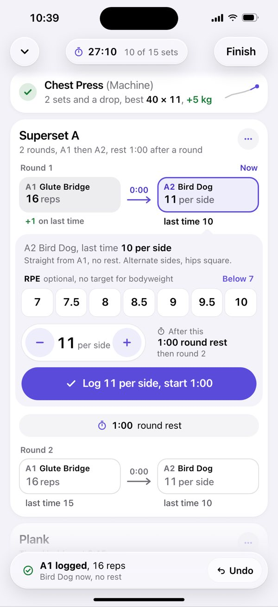

### 4. Resting, with what is next

Logging set 2 moved the drawer to set 3 and started the rest. The glass panel gives the time and says what is next in words; the thin bar inside chip 3 fills as the rest runs out. Set 3 can be adjusted while resting.

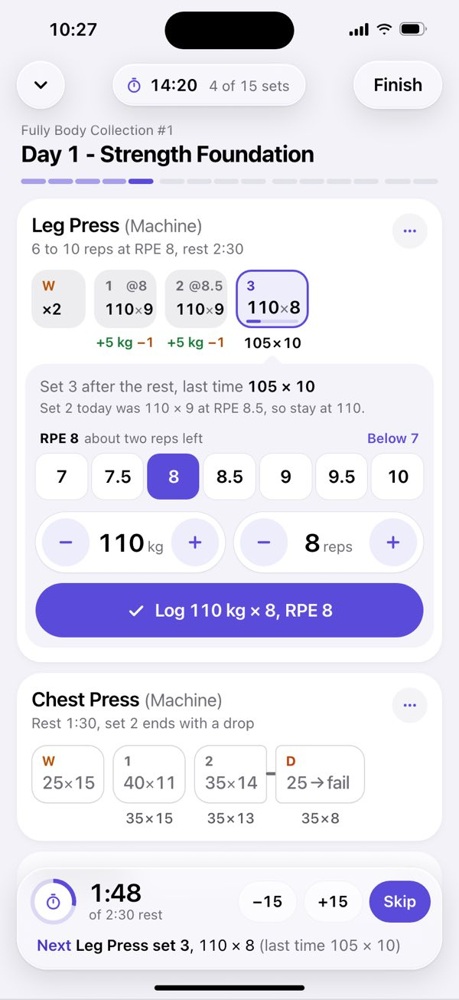

### 5. Chest press drop set

The drop chip (25 → fail) is welded to set 2 with an orange link. Logging set 2 opens it at once with no rest: load already stripped to 25 kg and RPE 10 set, so only the reps need a look.

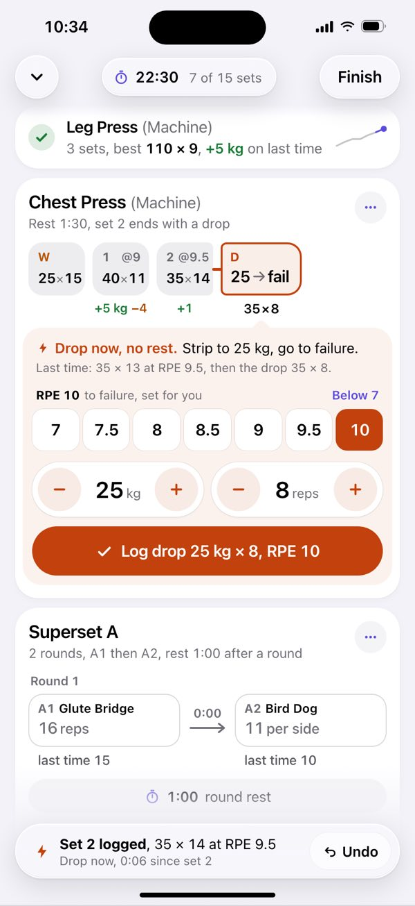

### 6. Timed plank running

A timed set swaps the steppers for a clock; the chip counts too. The bar has a tick at last time (1:02). Every finished exercise is one line, so the plank sits low and Stop is under the thumb. The capsule steps aside during a hold and comes back with the 0:15 rest.

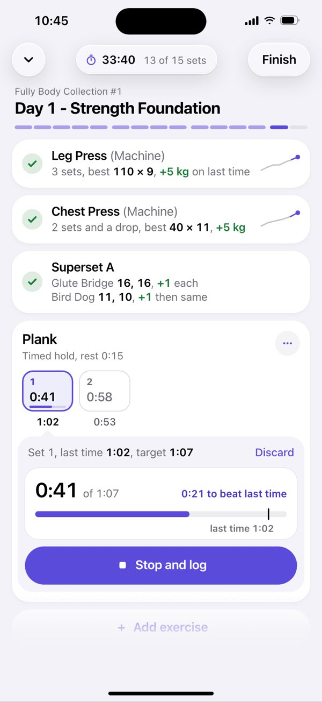

### 7. Fixing a past set

Tap any done chip and the same drawer opens on it, in orange, with Save instead of Log. Set 1 was really 8 reps: tap chip 1, tap minus, Save. The delta under it updates (+5 kg, −2). The rest timer and the next set do not move.

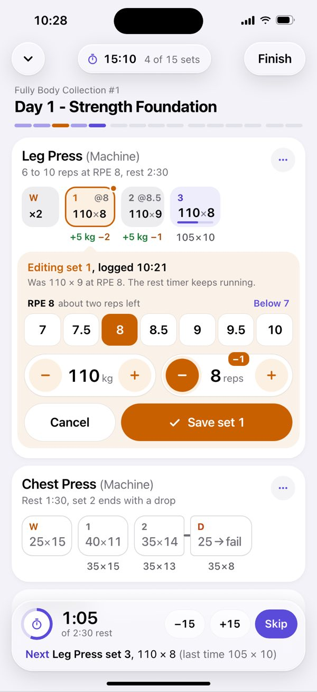

### 8. Doing a set out of order

The leg press is taken, so tap the chest press warm-up chip and the drawer jumps there. Leg Press set 3 turns into a dashed "later" chip, and the capsule keeps a way back until it is logged or skipped.

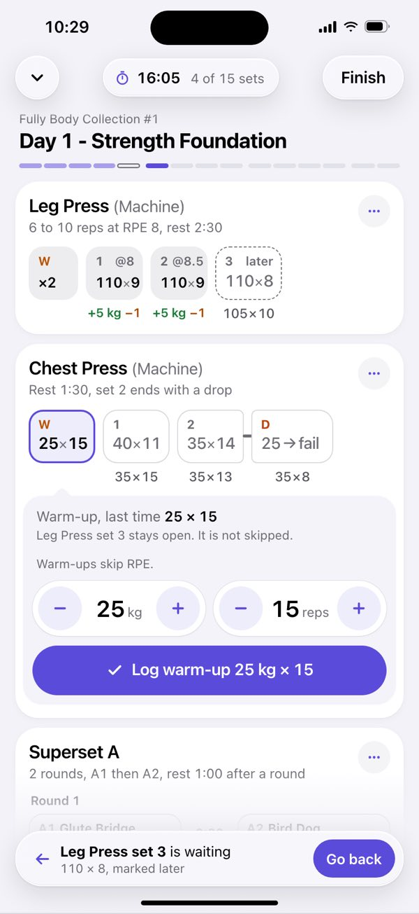

### 9. A big jump: the keypad

Tap the number in a stepper and a keypad takes the RPE ruler's place, inside the drawer. The old value is selected, so 9, 0 replaces it; Log stays where it was. Four taps for 110 to 90, no sheet, no system keyboard.

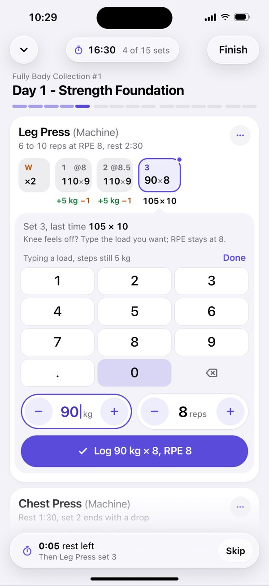

### 10. Myo-reps (example exercise)

Day 1 has no myo-reps, so Leg Curl is a made-up example, added after the plank (the count grows to 20 sets). The activation set and its mini-sets are one welded chain of chips, each with its own last time or change. The drawer holds only reps.

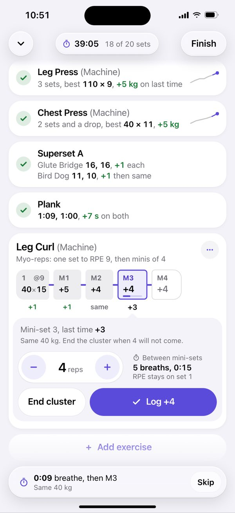

### 11. Dark appearance

Screen 1 in dark. Content stays opaque on black; only the toolbar and the capsule are glass.

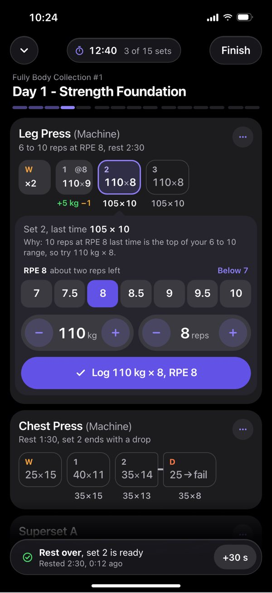

## The designer's rationale

Verbatim from the round's `chips/rationale.md`, written after a critique pass against the
owner's feedback and revised; screen numbers refer to the screens above.

### Spotter in-session: chips and one drawer

#### The idea

Each exercise is a compact card. Its sets form a row of chips (W, 1, 2, 3).
Each chip shows today's value. The line under a chip changes with its state:

- For a set still to do, it shows last time for that same set.
- For a set already done, it shows how today compares, as a plain change
  ("+5 kg −1").

Only one drawer is open in the whole session. It hangs off the chip for the set
to do now, with a caret pointing at it. From top to bottom it holds:

1. why the app suggests this set;
2. a 7 to 10 RPE ruler with half steps, already set to the target;
3. load and reps steppers that already know the exercise's step;
4. a Log button that repeats exactly what will be saved ("Log 110 kg × 8,
   RPE 8").

Logging moves the drawer to the next chip and starts the rest. Tapping any other
chip moves the drawer there instead. That one gesture covers editing a set out of
order, jumping to another machine, and fixing a set already logged.

When an exercise is finished, its card folds to one line ("3 sets, best 110 × 9,
+5 kg on last time"), so the session stays short. Supersets, drop sets and
myo-reps don't get their own screens. They use the same chips, arranged
differently:

- a superset is one strip per round, read left to right;
- a drop set or a myo cluster is a chain of chips welded together.

What makes it easy:

- **The editor is open before you reach for it.** Accepting the suggestion is
  one tap, RPE included.
- **The row mirrors the drawer.** Tap + and the chip above changes to 110 × 9
  at once, with a dot that marks a change from the suggestion.
- **Steppers, not text fields.** One load step is one tap, with no keyboard.
  Tapping the number swaps the RPE ruler for a keypad inside the drawer, for big
  jumps. Log never moves.
- **The controls are low.** The steppers sit just above Log, and after each Log
  the list scrolls so Log lands just above the glass capsule (screens 6 and 10).

#### Tap counts

These are counted on the in-session screen, with the drawer on the current set.
That is the state the app returns to after every Log and every edit.

| Task | Taps | How |
| --- | --- | --- |
| (a) Accept the suggestion and log | **1** | Log. RPE 8 is already set from the target and shown in the label. |
| (b) One rep fewer, then log | **2** | reps −, Log |
| (c) One load step up, then log | **2** | kg +, Log |
| (d) Set RPE 8.5 | **1** (2 with logging) | 8.5 on the ruler, a 50 × 44 pt target (then Log) |
| (e) Fix a set done earlier | **3** | tap the done chip, one stepper or RPE tap, Save |

Other paths:

- **Big load jump:** 4 taps (screen 9). Tap the number, then 9 and 0, then Log.
  The old value is selected when the keypad opens, so typing replaces it.
- **Do a set out of order:** 2 taps (its chip, then Log).
- **Undo the last Log:** 1 tap, in the capsule for a few seconds after each
  Log (screens 3 and 5).
- **Skip the rest:** 1 tap.
- **Stop a timed hold:** 1 tap.
- **Log a drop set:** 1 tap, or 2 if the reps differ. The drop chip opens with
  the load already stripped and RPE 10 set.
- **RPE 6 or 6.5:** 2 taps ("Below 7", then the value). The choice is
  remembered for that exercise.
- **Scrolled away from the active card:** add 1 tap. The capsule offers "Back to
  set 2", the same pattern as "Go back" on screen 8.

Fixing a set (e) never moves the rest timer or the next set. After Save or
Cancel, the drawer goes back to the set that was current.

#### How a lifter reads "what now" and "last time"

**What now.**

- Only one chip is tinted and outlined, and the drawer's caret points at it.
  Done chips are plain grey and chips still to do are white with a hairline, so
  the current chip stands out.
- The Log button spells out the set: "Log 110 kg × 8, RPE 8".
- During a rest, the glass capsule says it again in a sentence: "Next: Leg
  Press set 3, 110 × 8 (last time 105 × 10)". The thin bar inside chip 3 fills
  as the rest runs out, laid over the chip so its value does not move.
- A ribbon under the session title has one segment per set:
  - done segments are tinted;
  - the current set is solid;
  - a set left for later is hollow;
  - a set being fixed is orange.

**Last time.**

- The line under the current chip is last time for the same set, in bold black
  ("105×10"). Under later sets it is dark grey: #56565B, about 7:1 on white,
  14 pt medium. Nothing that carries data is faint.
- The drawer's first line repeats it ("Set 2, last time 105 × 10"). The second
  line gives the reason for the suggestion in plain words.
- Under a done set, the line becomes the change against last time, part by
  part: "+5 kg" in green, "−1" in amber, "same" in grey. It is never an estimated
  1RM mark, so adding 5 kg always shows "+5 kg". The signs carry the meaning
  without the colour.
- Warm-ups show no last-time line. Done warm-ups fold into one "W ×2" chip.
- The RPE of a done set sits in its chip ("@8.5") at 13 pt.
- A finished exercise's one-line summary carries the headline change
  ("+5 kg on last time"). A small sparkline of the top set over recent sessions
  appears there and nowhere else, with today's point in purple.

#### Special cases

- **Superset (screen 3).** Each round is one strip, read left to right:
  A1 Glute Bridge, an arrow marked 0:00, then A2 Bird Dog. A full-width "1:00
  round rest" pill comes next, then the round 2 strip. The exercise names are
  inside the chips. The drawer opens under the strip it edits. Its Log reads
  "Log 11 per side, start 1:00". The capsule offers Undo for the A1 just logged.
  When the superset is done, it folds to two lines (screen 6).
- **Drop set (screen 5).**
  - The drop chip reads "25 → fail". It is welded to set 2 by a short orange
    link, so it reads as "then".
  - Logging set 2 opens the drop at once, with no rest. The drawer turns
    red-orange and says "Drop now, no rest", with 25 kg and RPE 10 already set.
  - The capsule shows the time since set 2, with Undo for set 2.
- **Timed plank (screen 6).**
  - A clock replaces the steppers, and the chip counts too.
  - The bar has a tick at last time (1:02), and the drawer says how far you are
    from beating it.
  - "Stop and log" is the only big button. Discard is a small link.
  - The capsule hides during the hold and comes back for the 0:15 rest.
- **Out of order (screen 8).** Tap the chest press warm-up chip while the leg
  press is taken. Leg Press set 3 becomes a dashed "later" chip, and the capsule
  keeps "Go back" until that set is logged or skipped.
- **Fixing a past set (screen 7).** The same drawer opens on the done chip, in
  orange, with Cancel and "Save set 1". The change under the chip updates
  (+5 kg −2).
- **Big jump (screen 9).** A keypad takes the RPE ruler's place inside the
  drawer. It is not a sheet and not the system keyboard.
- **Myo-reps (screen 10).** Day 1 has no myo-reps, so Leg Curl is a made-up
  example added at the end (15 sets become 20).
  - The activation set and the mini-sets M1 to M4 form one welded chain of
    chips.
  - The drawer holds only reps, plus "End cluster".
  - The 5-breath pause runs in the chip and in the capsule.

#### What is new compared with Hevy

- **No grid.** There are no SET / PREVIOUS / KG / REPS / RPE / ✓ columns and no
  rows of text boxes. A set is one chip, with last time or today's change under
  it.
- **No text fields for ordinary changes.** A change is one stepper tap, and the
  steppers know the exercise's step. The keypad is only for big jumps, and it
  opens inside the drawer.
- **The editor opens itself.** It sits on the current set and moves on by
  itself after Log.
- **RPE in one tap,** on a half-step ruler with 50 pt targets. It is set to the
  target, so the RPE costs no tap when the set goes as planned.
- **Today against last time on every done set,** as a plain change in kg and
  reps.
- **Finished exercises fold to one line,** so the active exercise stays near
  the top and the session never becomes a long scroll.
- **Supersets read in lifting order,** one strip per round, with the 0:00
  transition and the 1:00 round rest drawn in the line.
- **Drop sets and myo-reps are welded chips,** part of the set they belong to.
- **Fixing a past set uses the same gesture as editing,** in a distinct colour,
  and it leaves the rest timer alone.

#### Liquid Glass, type and SwiftUI

- **Glass** is used only for floating controls: the collapse button, the
  duration pill ("12:40, 3 of 15 sets"), Finish, and the bottom capsule. Finish
  stays plain glass until every set is done, so it does not compete with Log.
  - Cards, chips and drawers are opaque.
  - Under the top bar, the scroll edge is opaque down to the bottom of the
    toolbar, then fades over 18 pt. Scrolled content never shows through
    between the bar's buttons.
- **Type.** No text is smaller than 13 pt.
  - Session title: 22 pt bold. Exercise names: 19 pt semibold (17 pt on folded
    cards).
  - Chip values: 17 pt (15 pt on done chips).
  - Chip labels, under-chip lines, hints and captions: 13 to 15 pt.
  - Stepper values: 24 pt. Keypad digits: 22 pt. The hold clock: 28 pt.
  - Units: chips, last-time lines and the capsule never say "kg"; the steppers,
    the Log label and the drawer's text do. The only exception is the change
    under a done set, where "+5 kg" names the unit so it is not read as reps.
- **SwiftUI.**
  - The chip row is a wrapping `Layout` of `Button`s. The drawer is one view,
    moved with `matchedGeometryEffect`.
  - A `ScrollViewReader` scrolls Log to just above the capsule after each Log.
  - The steppers use `.sensoryFeedback(.increase/.decrease)`, and holding one
    repeats.
  - The RPE ruler also takes a horizontal drag, with a haptic tick at each half
    step.
  - The capsule and toolbar use `.glassEffect()`, and the rest also runs as a
    Live Activity.
  - The "…" buttons draw 34 pt but have 44 pt hit areas.

#### Changes after review

Every major finding was fixed, along with most of the minor ones:

- **Contrast.** Last-time lines are darker (about 7:1).
- **RPE.** RPE starts on the target and appears in the Log label. The ruler
  covers 7 to 10 in seven 50 pt slots, all in the same weight and colour, with
  6 and 6.5 behind "Below 7".
- **Comparison.** Done sets show a plain change instead of the estimated 1RM
  marks.
- **Superset.** The two-lane grid became round strips.
- **Compactness.** Warm-ups fold into one chip, done chips are narrower and grey,
  rows wrap, and finished exercises fold to one line.
- **Scroll edge.** The top scroll edge is opaque under the toolbar.
- **Thumb reach.** The steppers moved down next to Log, and the list
  auto-scrolls after each Log.
- **Smaller fixes.**
  - Rest bar: laid over the chip, so the value no longer moves.
  - Welded chips: sized to their content, with a link between them.
  - Units: one rule throughout.
  - Labels: no tag below 13 pt, and the NEXT, LIVE and FAIL tags are gone.
  - Toolbar: "3 of 15 sets" is labelled, and Finish is plain glass.
  - Capsule: it now carries Undo, the rest controls, "+30 s" and "Go back". It
    hides during a hold.
  - Myo screen: the plank is shown and the set count is updated.
  - Sparkline: only on finished exercises.
  - Screen 9: shows the keypad.

#### Risks

1. **The prefilled RPE can be logged without thinking.** Starting on the target
   makes (a) one tap, but a lifter may stop setting RPE at all, which weakens the
   next suggestion. The Log label states the RPE every time. If RPE stays on the
   target on every set for several sessions, the app could ask once. The
   alternative is to start blank ("RPE not set"), which costs one tap per set.
2. **The first exercise's drawer sits mid-screen.** Nothing is above it to
   scroll, so on screens 1, 2, 4 and 7 the steppers are about 540 pt down and Log
   about 600 pt. That is reachable, but not ideal on a Pro Max. From the second
   exercise on, the folded cards above let auto-scroll place Log just above the
   capsule.
3. **Width.** Chips size to their content and the row wraps. A 102.5 kg load
   makes a chip about 90 pt wide, and six working sets wrap to a second line.
   That pushes the drawer down by about 76 pt.
4. **Auto-advance can surprise.** After Log, the drawer moves, sometimes into
   another strip or another exercise. Two things soften this: the Log label names
   what follows ("start 1:00"), and the capsule offers Undo for a few seconds.
5. **A mixed change reads two ways.** "+5 kg −1" is green and amber at once. The
   signs carry the meaning, but some lifters will want one verdict. The folded
   summary gives the headline, and tapping the chip shows the full last time.
6. **Edit and drop colours are close.** Both are warm (orange and red-orange).
   The drawer's first line names the mode, so colour is never the only signal.
7. **Hidden gestures.** Tapping a stepper's number for the keypad, scrubbing the
   ruler, holding to repeat, and expanding the W ×2 chip are not visible. They
   need a first-session hint.
8. **Myo-reps and drop sets are not in today's routine.** The data model needs
   a "cluster" link between sets for both.
