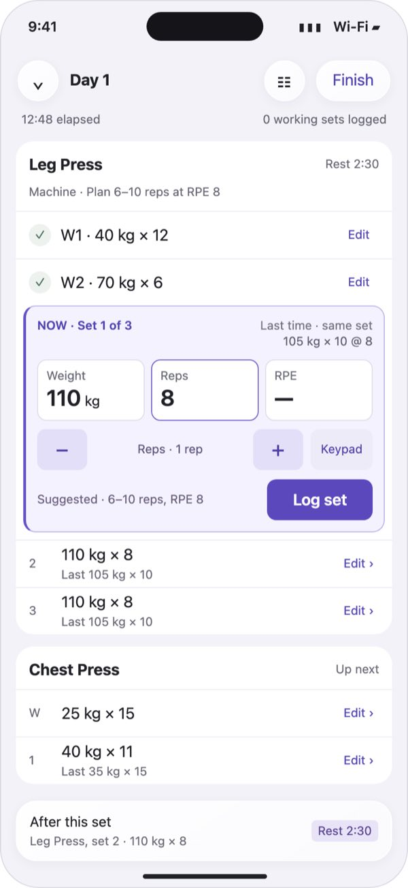
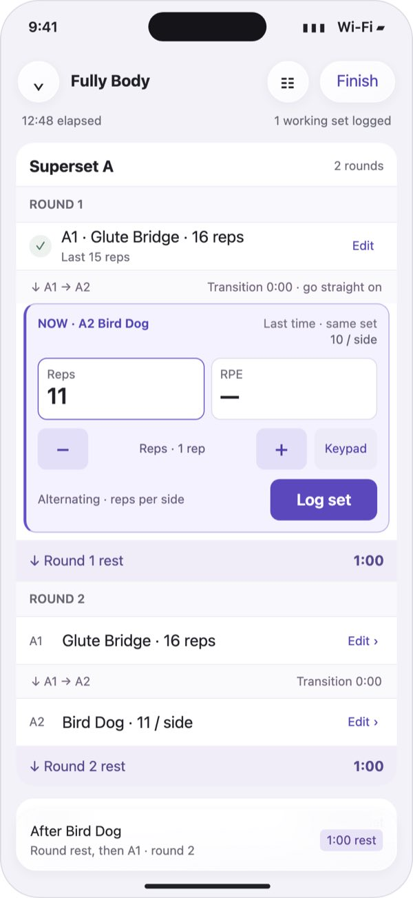
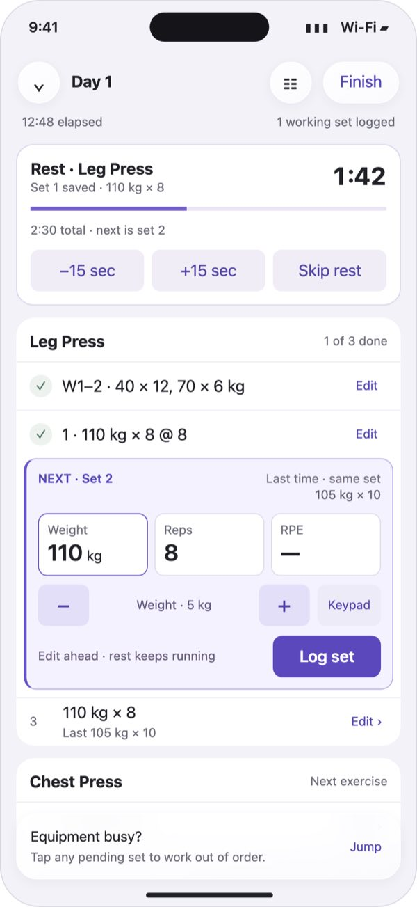
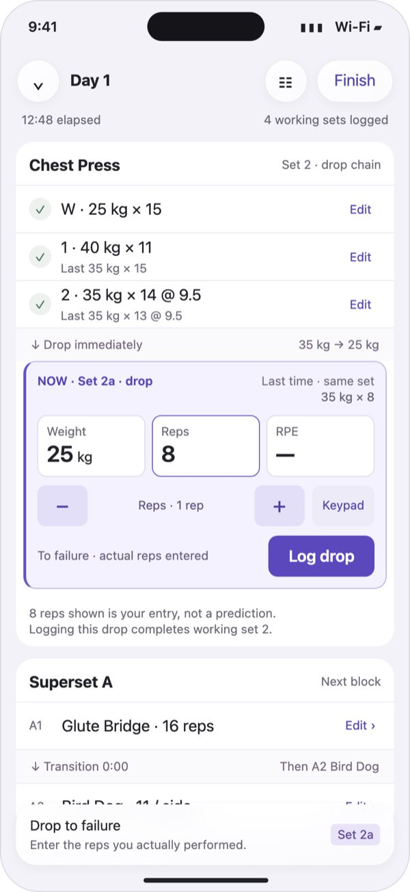
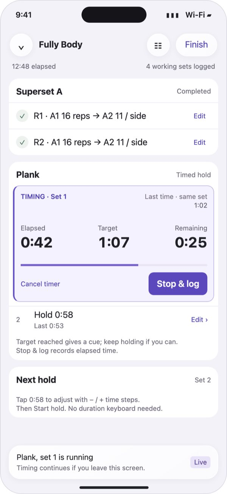
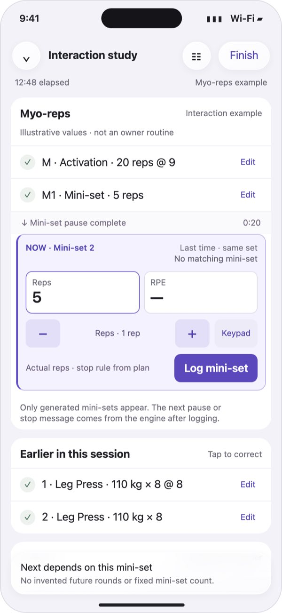
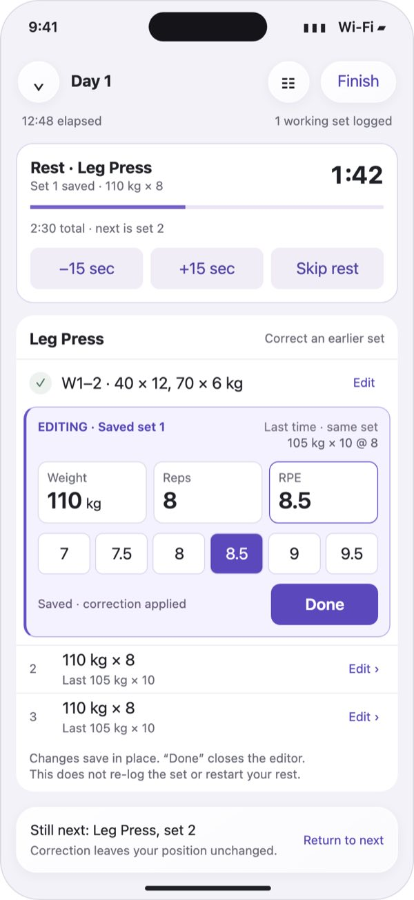

# F. Set list (Codex)

Status: not chosen (the owner picked Rows, 2026-10-31). Codex Astra's own concept for the second round.

A static mockup from the second design round, 2026-10-31, drawn at iPhone Pro Max size
with the owner's real Day 1 plan. The round's brief is in [../README.md](../README.md#the-second-round).

Sets read as short receipts. The current set shows labelled Weight, Reps and RPE fields; tap one and a single −/+ row edits it. A superset round is the unit of work, with the transition and the round rest written as rows between the exercises.

- **Good at:** The calmest of the four, with the least on screen and clear labels.
- **Watch for:** Every change takes one more tap, because the −/+ row is shared between weight, reps and RPE.

## Screens

### 1. Edit where the value lives

### 2. A round is the unit of work

### 3. Rest keeps the next set editable

### 4. Drop sets stay attached to their parent

### 5. A hold uses the same set list

### 6. Chains expand only as needed

### 7. Correct without undoing the workout

## The designer's rationale

Verbatim from the round's `codex/rationale.md`, written after a critique pass against the
owner's feedback and revised; screen numbers refer to the screens above.

### Set List — second design round

One concept, seven static snapshots. Open index.html and scroll horizontally. Each phone is exactly 440 × 956 CSS px, including its border; phone content scrolls vertically when needed. All fonts, CSS and graphics are local. No repository files were changed.

#### Idea

Keep the workout readable as a list of short set receipts. Expand only the set being edited, in its original place. Its load, reps and effort are individually labelled buttons; tapping one exposes a local stepper below those buttons. The same position holds a direct half-point picker for RPE. There are no shared column headings or repeated spreadsheet cells across sets. Completed and future sets are sentences; only the selected set becomes a small control surface.

Body text is 17 px, supporting text 13–15 px, values 24 px, rest countdown 26 px and hold clock 28 px. Nothing exceeds 28 px. Native implementation uses corresponding scalable system text styles. Purple edge plus the literal NOW label identifies the active set; EDITING and NEXT distinguish correction and preparation from execution. Matching previous values sit beside the set identity, above its current values. RPE is initially unrated: a planned RPE 8 must never silently become a logged RPE 8.

Liquid Glass belongs only to floating navigation buttons and the bottom context dock. Exercise sections, fields, steppers and rest panels are opaque. HTML approximates the material; it does not prove native iOS rendering. Use native materials and accessibility settings in SwiftUI.

#### Exact tap paths

Counts start with the relevant set visible. Scrolling to another set is navigation, not a hidden edit step. All numeric fields are individually tappable even in a compact receipt; its Edit action also expands the editor. The static snapshots illustrate states, not working JavaScript controls.

| Task | Actions | Taps |
| --- | --- | --- |
| Accept suggestion | Log set | 1 |
| One rep fewer, then log | Tap reps → minus → Log set | 3; 2 with reps editor already open |
| One weight step up, then log | Tap weight → plus → Log set | 3; 2 with weight editor already open |
| Set RPE 8.5 | Tap RPE → 8.5 | 2; add Log set for 3 total |
| Fix an earlier set by one rep | Tap its rep value → minus | 2 to persist correction; optional Done is a third tap to close |
| Fix an earlier set via Edit | Edit → select desired field → minus/plus | At most 3; Done only closes |

The RPE picker opens centered on the plan or existing rating and includes adjacent half-points, so 8.5 is immediately visible for this RPE-8 plan. The full legal scale remains horizontally accessible, with an explicit Clear action in implementation. RPE buttons and steppers have at least 44 × 44 pt targets; step size is supplied by the model. A keypad is an optional shortcut for large changes. Neither a sheet nor the keyboard appears for ordinary changes. Selecting 8.5 saves that rating directly. It is not rounded to an integer.

Field changes use editSet and persist immediately. Logging is separate: a changed suggestion is not a completed set. Saved-set edits do not uncomplete/recomplete the row. Done merely dismisses the inline editor. Display saving/errors honestly; only show “correction applied” after the journal write succeeds. A failed edit retains its draft for retry. Provide an inline Undo correction action after a successful change.

The ordinary log path has no confirmation tray. Use current commitValues and the existing entry-warning gate. Invalid or missing fields disable Log and explain what is missing. Serialize command handling and disable the original button until the completion is journaled, preventing repeated taps from completing a newly focused row.

#### The seven screens

1. **Leg Press:** both warm-ups remain visible above the selected first working set. Suggestions are 110 kg × 8; the first set's actual reference is 105 kg × 10 @ 8. Later references omit effort because none was supplied. Work sets 2 and 3 and Chest Press remain visible. Weight steps are 5 kg; rep steps are 1.
2. **Superset:** round-first layout, A1 then A2 then 1:00 rest, followed by round 2 in the same order. A1 round 1 is complete; A2 round 1 is current. The 0:00 transition is a visible “go straight on” connector, not a flashing countdown. Bird Dog is alternating reps per side, not two invented side records. The round-rest connector becomes a live countdown after A2; its next label points to A1 of round 2. Final-round rest follows the engine's configured rest policy.
3. **Rest:** 1:42 remains of the 2:30 Leg Press rest. Set 2 is already editable. Editing does not skip or restart rest. The rest controls are explicit −15, +15 and Skip. Warm-up receipts are summarized here to leave room for another exercise; each original row remains separately addressable when expanded.
4. **Drop:** Chest Press head set 2 is saved at 35 × 14; its historical reference remains 35 × 13 @ 9.5. The connected drop is 25 kg to failure, compared with the historical 35 × 8. The displayed 8 actual reps is an illustrative user entry, not an accepted prediction. Initially this field says “Enter reps” and logging is disabled; tapping it opens the inline actual-reps control. Missing actual reps do not inherit previous reps automatically. The normal three-tap adjustment guarantee concerns existing values, not inventing an unknown failure result.
5. **Plank:** elapsed, target and remaining are 28 px. Target 1:07 is compared with set 1's 1:02; set 2 retains 0:58 versus 0:53. Start uses the suggested/edited duration, Stop & log saves elapsed time. The target cue never completes a hold automatically. Overtime remains visible; there is no invented pause feature.
6. **Myo-reps:** explicitly illustrative data, not an owner routine. A saved activation and one mini-set precede the current generated mini-set. Its pause is separate from between-set rest. No ungenerated mini-sets are drawn. After logging, the core supplies the next mini-set or stopText; render the stopping explanation inline. A locked continuation explains its prerequisite rather than offering completion.
7. **Correction:** an earlier completed Leg Press set stays in place with RPE 8.5 selected. Rest continues and set 2 remains next. The correction does not move execution focus.

Out of order: tapping any pending row's value selects that row and opens the chosen inline editor in one tap. An explicit pending-row selection sends touchRow; merely scrolling or looking at history does not. The NOW marker and bottom next context follow the resulting presentation. Locked dependent chain rows remain unavailable, with the reason visible. Tapping a done row enters correction mode without touchRow. Jump navigates to exercises; it does not log or reorder them. There is no swipe or long-press requirement.

#### Mapping to SessionPresentation

The controller remains the sole writer. Use the existing apply → journal → present loop described in apps/apple/spotter/SpotterKit/API.md. Views render data and send commands; they do not compute progression, group scheduling or chain stop rules.

| Design surface | Existing source / command |
| --- | --- |
| Session toolbar, elapsed and progress | title, header.clockStart/clockPausedAt, header.setsText; warm-ups excluded from working progress |
| Exercise sections and navigation | blocks, cards, ExerciseCard.name, groupLabel, progress, notes, planNotes |
| Compact receipts and NOW state | SetRowPresentation.label, state, cells, rpeText; stable row IDs |
| Editable value buttons | cells.text/entered/isGhost/isHint/isMissing; retain existing accessibilityLabel and accessibilityValue(draft:) |
| Inline edit step sizes | ExerciseCard.loadStep/timeStep; integral reps; RPEScaleText.values for legal effort values |
| Matching historical reference | row.previous.text; nil means no matching prior set, never an aggregate best set |
| Suggestions and plan explanation | row.reason, row.suggestion?.text; preserve suggested-versus-entered distinction |
| Commit | canTick, missing and commitValues, then EntryCheck and completeSet |
| Value changes and corrections | editSet with the specific row ID and typed SetValuesPatch; never edit displayed strings |
| Focus another pending row | touchRow; do not touch a completed row when correcting it |
| Rest display | exhaustive restBar switch, RestCountdownPresentation.label/endsAt/next; adjustRest and skipRest |
| Next context dock | upNext.line/values/exerciseWithGroup/round; preserve actual focus after out-of-order work |
| Timed hold | row.timer.ready target → startTimedSet; running state → timer display; stopTimedSet with stopValues; cancelTimedSet |
| Chain completion message | row.stopText; preserve it after focus advances |
| Refresh and secondary surfaces | nextChange, accessory, liveActivity, notification remain coordinator-owned |

Do not render columns or columnTitles as a table. They can still supply the semantic field names and units. RPE entry stays available on applicable weighted/reps rows; canRateEffort is not a blanket gate for them. Timed rows can expose the existing effort capability with the same inline picker. Historical copy, if offered, uses previous.copy and never copies RPE implicitly. All production value formatting uses Format.

##### Small presenter addition required

Existing group members and row labels do not safely encode complete execution order, round membership or chain parentage. Add a pure presentation projection with stable set IDs and typed edges:

- ordered set nodes: rowID, slotID, round if applicable, chainHeadID and chain position;
- rest edges: preceding/following row IDs, typed rest kind and duration, including zero transitions;
- row context: per-side semantics, formatted plan target and locked prerequisite explanation;
- chain context: actual generated row IDs and a conditional continuation marker or stop explanation.

Derive these in core from its existing sequencing/rest rules. Never parse “A1”, “2a”, “M” or English rest labels to infer behavior. Re-project after each event, including corrections that regenerate pending chain members. Do not pre-simulate future myo results. This is presentation data, not a second scheduler or a persisted execution state. No new completion event or data migration is required by this concept.

The selected field, expanded row and temporary edit draft are local view state. Keep correction focus separate from execution focus. Bind every action to its row ID; if an external event removes or completes it, close or refresh its editor visibly rather than applying a stale action to another row.

#### Implementation and accessibility checks

Keep 44 pt targets, distinguish states using words and shape as well as color, and reuse the model's VoiceOver values. Announce completion and timer boundaries once, not every second. At larger Dynamic Type sizes, wrap receipts and stack fields vertically; allow scrolling rather than shrinking type. Reduce Transparency makes the floating dock opaque. Do not automatically scroll away while the user is editing or browsing.

These are static design snapshots, not a tested SwiftUI implementation or a continuous replay. The owner data is retained; performed values and elapsed times illustrate different states. The source generator build.py is also confined to this output directory. No app builds or repository checks are needed for these standalone design artifacts.
