# E. Direct

Status: not chosen (the owner picked Rows, 2026-10-31).

A static mockup from the second design round, 2026-10-31, drawn at iPhone Pro Max size
with the owner's real Day 1 plan. The round's brief is in [../README.md](../README.md#the-second-round).

The numbers are the controls. Weight and reps are dials: − and + for one step, or drag the ruler under them for a bigger jump. A thin bar on every set compares today with last time (by estimated one-rep max), and Log floats at the bottom under the thumb.

- **Good at:** Big jumps without a keypad, today against last time at a glance, and Log always in the same place.
- **Watch for:** Dragging needs care with sweaty hands, and Log sits further from the values it saves.

## Screens

### 1. Set 2 is open, in place

Done sets are one line; warm-ups fold into one. The open set is the only editor: weight and reps are dials with − and +, and last time is written under each value (the grey dot on the ruler is the same number). The bar in its header compares the plan with last time. Nothing is preset on the RPE strip, and Log says so: “no RPE”. Below, the chest press shows its planned drop as a sub-row of set 2. + beside ⋯ adds a set.

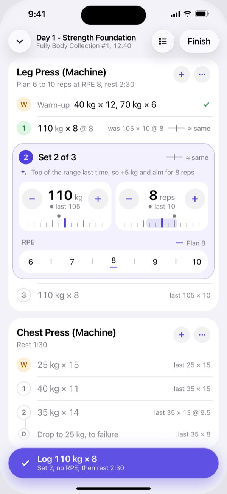

### 2. One tap on + under reps: 8 → 9

The dial moves one detent with a haptic tick. The edited value turns accent, the triangle keeps the suggestion (8) in view, the bar goes from “≈ same” to +2%, and Log now reads 110 kg × 9. Log is the second tap.

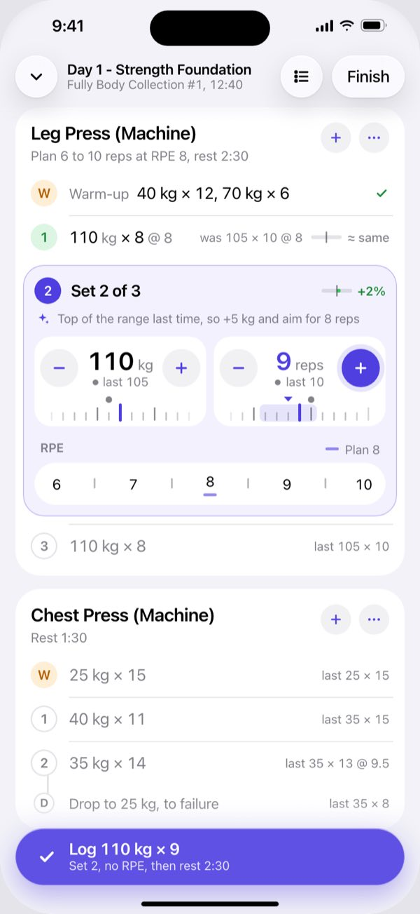

### 3. Superset, top to bottom in the order you do it

Round 1: A1, then 0:00 straight to A2, then the 1:00 round rest, then round 2. The transition and the rest are rows on the rail. Bodyweight moves get one wide reps dial. Done exercises fold to one line above, so the open set sits in the lower half, close to Log.

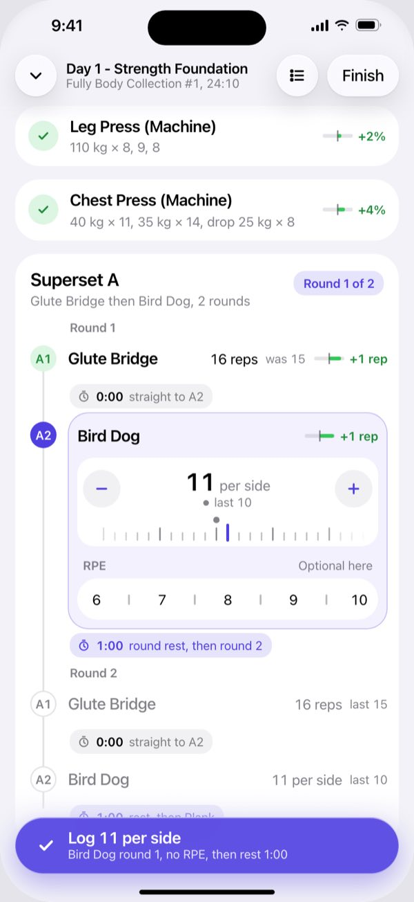

### 4. Resting: the next set is already open

Set 2 was logged at 110 kg × 9 @ 8.5 and shows +2% on last time. Set 3 is open with a fresh suggestion, and its strip is the only RPE control on screen. The rest timer is a glass capsule beside Log. Logging set 3 ends the rest, so there is nothing to dismiss. Tap the capsule for −15, +15 and Skip.

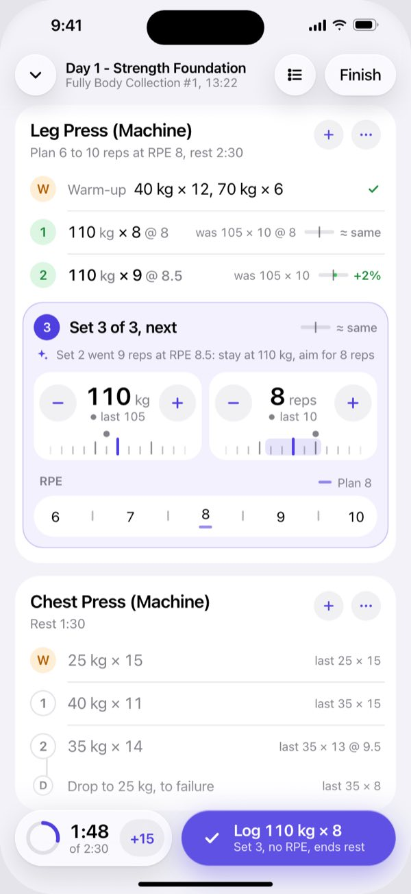

### 5. Chest press drop, straight after set 2

The drop was on screen all along as a sub-row under set 2 (“Drop to 25 kg, to failure, last 35 × 8”). Now it opens on the same rail. Weight starts at 25 kg with last time’s 35 kg written under it; reps start at last time’s 8. To failure sets RPE 10 for you, and Log shows it. No rest runs until the drop is logged.

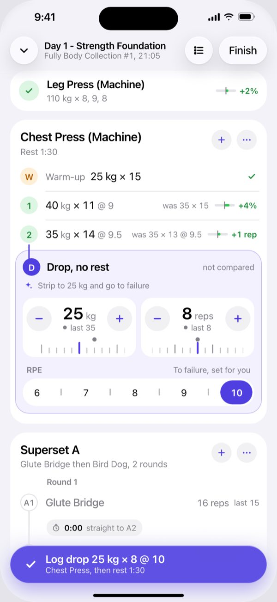

### 6. Timed plank, running

The same today-versus-last language, live. The grey dot is last time (1:02) and the accent tick is today’s goal (1:07). Past the dot, the bar turns green, and one delta says by how much. Stop logs the time. If you stopped late, the time opens as a dial in 5 s detents.

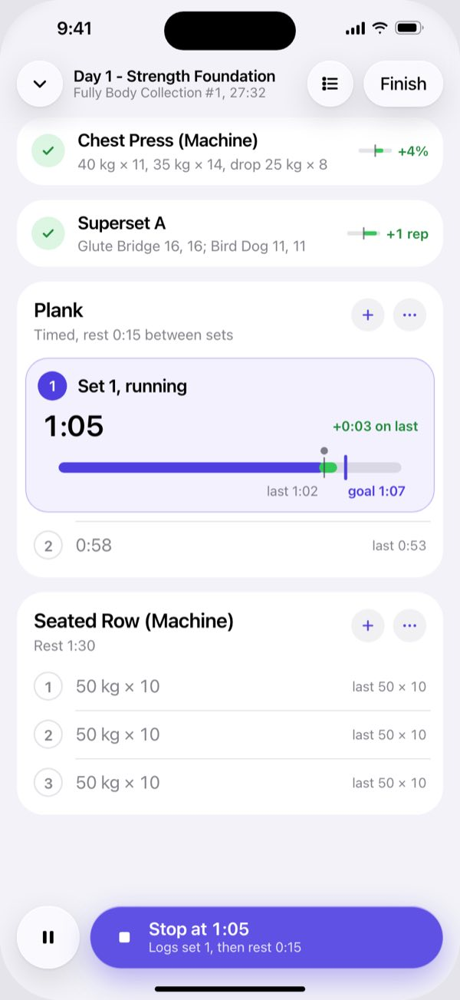

### 7. RPE 8.5 is one tap

Half steps are the short ticks between the numbers; each one is a full-height target about 40 pt wide. The tapped cell widens to show 8.5. The light band marks the plan (8). Log now ends in “@ 8.5”, so you can see the RPE that will be saved.

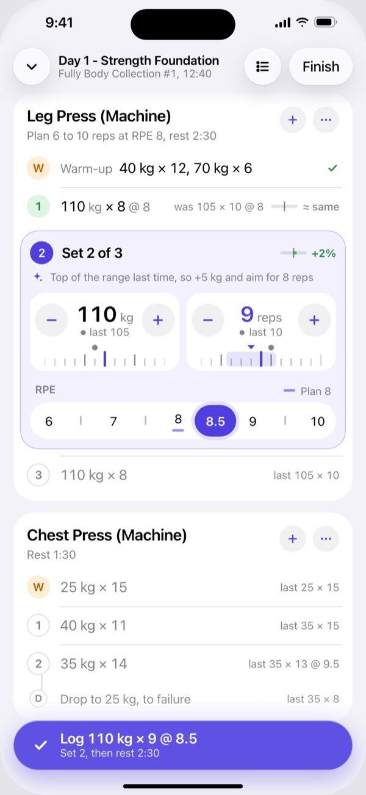

### 8. Drag for bigger changes

Press and drag along a dial and a glass loupe lifts over the top of the card, out of the way of your thumb. It has labelled detents: one 5 kg step per tick, a haptic tick each, and tall ticks on 100 and 125 as on the dial. Last time (grey dot) and the suggestion (triangle) stay marked, and the bar and Log follow live. Tap the number for a keypad when the jump is huge.

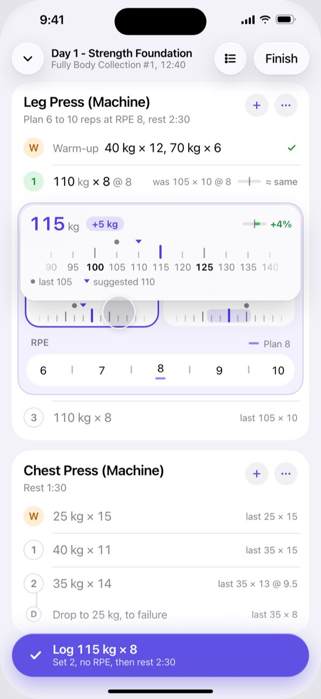

### 9. Fixing a set done earlier

Tap any done row and it opens as the same editor in grey, so it never looks like the set to do now. Set 1 was really 7 reps: tap the row, tap −, tap Save. The triangle marks what was logged (8). Set 1 is the one set with a last-time RPE, so its strip shows the grey dot under 8. Set 2 waits as one line and reopens after Save.

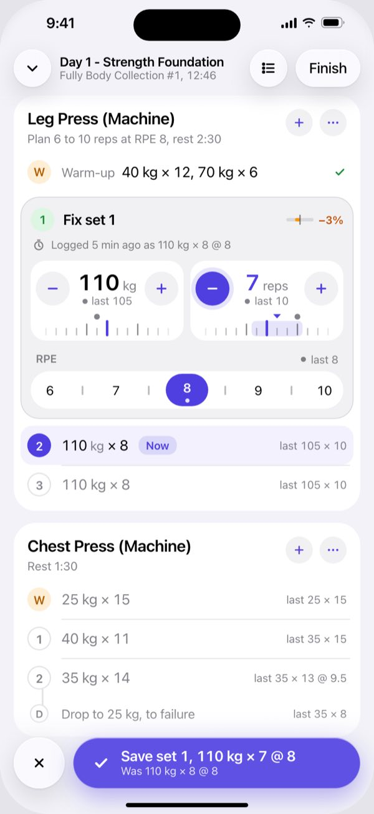

### 10. Session outline, and doing things out of order

From the list button, in the one session order every screen uses. Every upcoming row has the same two swipe actions, Do now and Later, and long-press drags to reorder. The seated row machine is busy, so Do now on the lateral raise opens it; the seated row waits, tagged Later, with its suggestions kept.

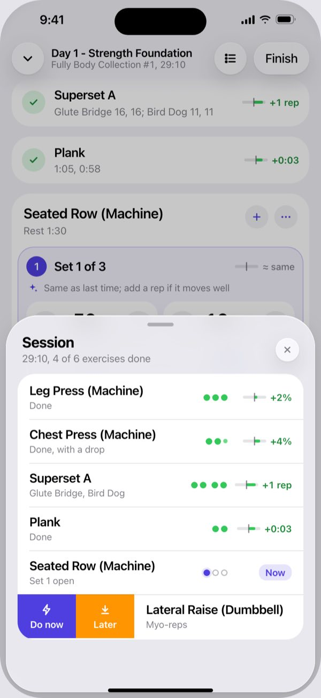

### 11. Myo-reps: one chip per mini

The activation set logs like any set. Each mini is a chip that starts at 5, with last time’s count under it, the same way the dials show it. Nudge with − or + if you got a different count, then Log. A short breathing timer replaces the rest, ghost chips show what is left, and End cluster stops when you miss 5. The lateral raise numbers are illustrative.

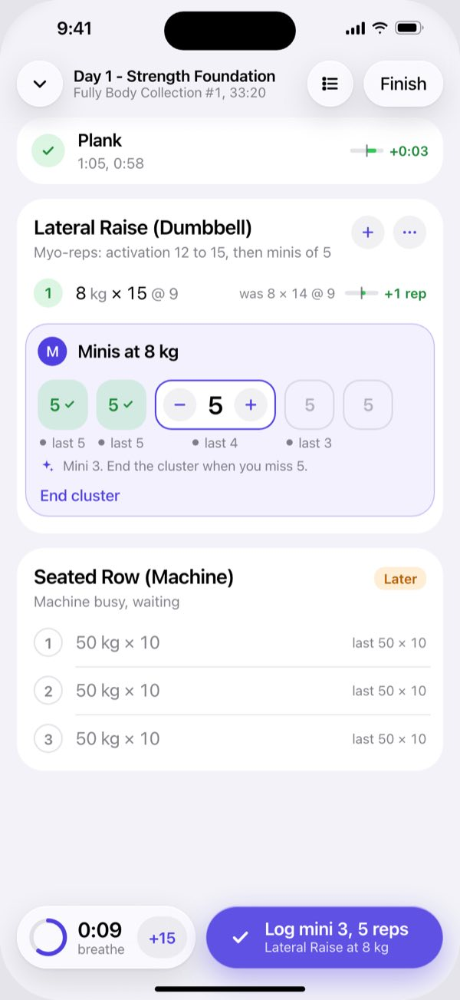

### 12. Dark appearance

The same moment as screen 1. Content stays opaque on black. Only the toolbar buttons, Finish and Log are glass.

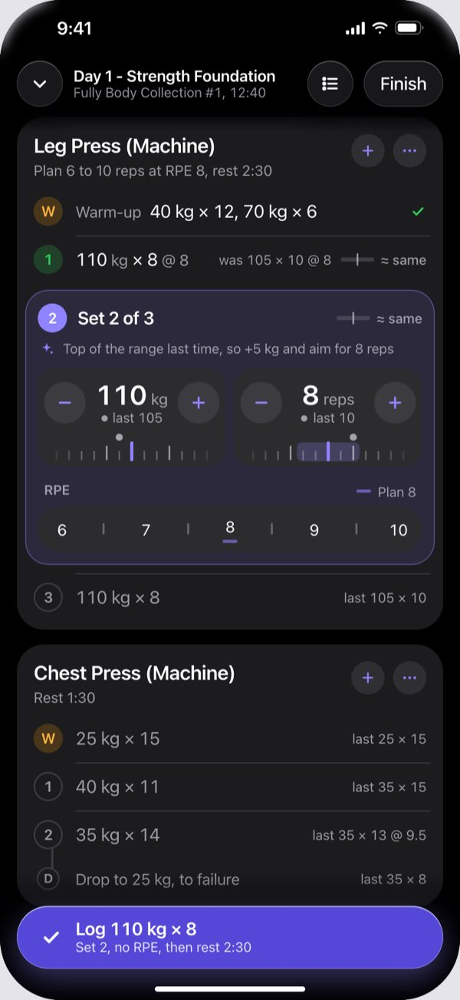

## The designer's rationale

Verbatim from the round's `direct/rationale.md`, written after a critique pass against the
owner's feedback and revised; screen numbers refer to the screens above.

### Spotter in-session, concept "direct": the numbers are the controls (revision 2)

#### The idea

The session is one scrolling list of exercises, and each set is a single line (`110 kg × 8 @ 8`). There is no column grid and no header row. Only the open set ("now") becomes an editor, in place:

- **Weight and reps are small detent dials.** Each has − and +, and a tick ruler you can drag with one detent and a haptic tick per load step or rep.
- **Last time is written under each value** (`last 105`, `last 10`). The grey dot on the ruler marks the same number.
- **RPE is a strip from 6 to 10 that sets in one tap.** Whole numbers are labelled, half steps are ticks between them, and it is the only RPE control on screen.
- **Every set carries a thin today-versus-last bar,** and the open set's bar updates while you edit.
- **Log is a Liquid Glass button at the bottom** that names exactly what it will save, including the RPE or "no RPE".

Every ordinary change is a tap or a drag on the number you are looking at. Nothing types, and no sheet opens.

#### What changed after the critique

**RPE model (major):**
- **One RPE strip on screen at any time.** The "How hard was set 2?" strip on the resting screen is gone. The open set's editor holds the strip, and you rate the set you just did before you tap Log.
- **No ring.** Fill now means "selected" and nothing else. The plan is an accent dash under the number, and last time is a grey dot under it. Each is explained by a key in the strip header ("Plan 8", "last 8").
- **Log says what will be saved.** It reads `Log 110 kg × 9 @ 8.5` once RPE is set, and `Set 2, no RPE, …` while it is not (screens 1, 2, 7).

**Last-time binding (major):**
- Last time is matched per set index. Set 1 reads `was 105 × 10 @ 8`; sets 2 and 3 read `105 × 10` with no RPE.
- The set 2 and set 3 strips show "Plan 8" only. Only set 1's strip (screen 9) carries the last-time dot.
- Chest press set 2 reads `last 35 × 13 @ 9.5`.

**Minor fixes:**
- **Last time is said once per value.** It sits under each dial value, and the header line holds only the verdict bar. The reason line now gives only new information: "Top of the range last time, so +5 kg and aim for 8 reps".
- **One title.** It is always "Day 1 - Strength Foundation", with "Fully Body Collection #1, 12:40" as a constant subtitle.
- **One session order everywhere:** Leg Press, Chest Press, Superset A, Plank, Seated Row, Lateral Raise. The collapsed cards on every screen and the outline (screen 10) follow it. The seated row is moved Later at 29:10.
- **Units follow one rule.** The primary value carries kg; comparisons ("was", "last") omit it. Every done row has the same was, bar and verdict trio, superset A1 included (`16 reps, was 15, +1 rep`).
- **Cards run on under the bottom bar** instead of ending early, so chest press and Superset A are visibly complete lists.
- **The planned drop shows before it starts,** as a sub-row under chest press set 2: "Drop to 25 kg, to failure, last 35 × 8" (screen 1). It opens on the same rail in screen 5.
- **The plank card says each thing once:** the clock, one live delta, and the bar labels "last 1:02" and "goal 1:07". The pending row reads `0:58` with `last 0:53`.
- **Finish is a plain glass text button,** so Log is the only prominent action.
- **Drag loupe:**
  - Its glass is dense and spans the top of the editor, so no text ghosts through or gets sliced.
  - End labels fade inside the loupe instead of clipping.
  - Both rulers are uniform, one tick per step, with tall ticks on round values (every 25 kg, every 5 reps).
  - The loupe carries the live verdict and a legend.
- **Outline:**
  - The instruction footer is gone.
  - Every upcoming row has the same swipe actions, Do now and Later, and long-press reorders.
  - Pills show state only (Now, Later).
  - Superset A is one row with its rounds as paired dots.
- **"stay at 110 kg, aim for 8 reps"** now names its units.
- **Add set moved to a + beside each exercise's ⋯ button.** That freed the space that makes the drop sub-row visible.

#### Tap counts

The open set is always in edit mode, so starting to edit it takes 0 taps. Any other set opens with 1 tap on its row.

| Task | Taps | How |
| --- | --- | --- |
| (a) Accept the suggestion and log | **1** | Log. Log reads "no RPE", so you know nothing is rated. To log with the plan RPE: 8, then Log (2). |
| (b) One rep fewer, then log | **2** | − on reps, then Log |
| (c) One weight step up, then log | **2** | + on weight (+5 kg), then Log |
| (d) Set RPE 8.5 | **1** | The tick between 8 and 9, a full-height cell about 40 pt wide. Log then ends in `@ 8.5` (screen 7). |
| (e) Fix a set done earlier (one step) | **3** | Tap the done row (it opens grey, in fix mode), − or +, then Save. × cancels. |

- **Bigger changes:** press and drag a dial. A loupe with labelled detents lifts over the top of the card, and a flick coasts.
- **Huge jumps:** tap the number for a keypad. This is the only typing path.
- **Long-press on − or +** repeats the step.

#### How a lifter reads "what now" and "last time"

**What now:**
- Only one block on the screen is tinted and outlined, and only it holds controls. Its marker is filled accent.
- The Log button names the values and the set, and it is the one prominent button on screen.
- During a rest, the next set is already open and prefilled (screen 4).
- In a superset, the open block sits on the rail between "0:00 straight to A2" and "1:00 round rest" (screen 3).

**Last time:**
- **On the open set:** `last 105` sits directly under `110 kg`, and `last 10` under `8 reps`. The grey dot on each ruler is the same number, and the tinted band on the reps ruler is the plan range (6 to 10).
- **On the RPE strip:** a grey dot under a number marks last time's RPE, shown only when that set recorded one.
- **On upcoming rows:** `last 105 × 10`, with `@ RPE` only when it was recorded.
- **On myo minis:** each chip has its own `last 4` caption.

**How today compares, for done sets:** each row reads `was 105 × 10`, then a 34 pt bar and a short verdict.
- The centre tick of the bar is last time. Green to the right means stronger, orange to the left means weaker, and within ±1% it reads "≈ same".
- The bar compares estimated 1RM (Epley), so 110 × 8 against 105 × 10 reads as level rather than "2 reps down".
- The verdict text says the simplest true thing: `+1 rep`, `+4%` or `≈ same`.
- The open set's bar previews the comparison live: 8 → 9 reps turns "≈ same" into "+2%" before you lift.

**One visual vocabulary, used everywhere:**
- accent = today
- grey dot = last time
- accent band or dash = plan
- small accent triangle = the value before your change (the suggestion, or what was logged when fixing)

#### What is new compared with Hevy

- **No grid, no PREVIOUS column, no header row.** A set is a sentence, and only the open set grows controls. Done sets stay one line, and warm-ups fold into one.
- **The values are the controls.** Hevy needs a tap on a box, a keypad, typing and a tick. Here a change is − or +, or a drag with detents and haptics.
- **Last time sits on the control itself,** under each number. A verdict bar replaces Hevy's raw "previous" text, and it previews progressive overload while you edit.
- **RPE takes one tap inline, half steps included,** and the Log label confirms it. Hevy opens a bottom panel with a slider.
- **Supersets are a timeline in execution order,** with transition and round-rest rows. Hevy shows separate exercise cards.
- **The rest timer sits beside Log, and logging ends the rest,** so there is nothing to dismiss.
- **Fixing a set opens the same editor in grey,** so it can't be mistaken for the set to do now. The bottom button becomes Save, and × cancels.
- **Out of order:**
  - Tap any upcoming row to make it now, or use Do now or Later in the outline.
  - Skipped exercises keep their suggestions and wait, tagged Later.
- **Drop sets** are visible ahead of time as a sub-row and open on a rail under their parent set, with RPE 10 preset for "to failure".
- **Myo-reps** are a row of nudge chips, each with last time's count under it. A breathing timer replaces the rest.

#### Risks

- **Log is not always next to the dials.** Done exercises fold into one-line cards, so from the second exercise on the open set sits in the lower half, near Log (screens 3, 5). The first exercise of a session has nothing above it, and its editor sits mid-screen, about 300 pt above Log (screen 1). Moving Log into the card would fix that, but Log would no longer sit in the one fixed spot you can hit without looking. This needs gym testing.
- **RPE is rated before Log, not after.** A lifter who taps Log straight away and wants to rate afterwards must tap the done row (fix mode), pick the RPE and Save: 3 taps. If testing shows that is common, a just-logged row could take the strip for the length of the rest, with the next set's strip hidden meanwhile, so there is still only one strip on screen.
- **The plan dash and the last-time dot are small** (14 × 3 pt and 5 pt). They support the words in the strip header ("Plan 8", "last 8"), which carry the meaning at arm's length.
- **Dials can read as decoration.** The − and + buttons are the primary path, and dragging is a bonus. If nobody drags, the ruler can shrink to a ticked hairline.
- **Gesture conflict.** A horizontal drag on a dial inside a vertical list must lock only on clear horizontal intent, or scrolling will nudge weights. The buttons are 40 pt with 44 pt hit areas.
- **The RPE strip packs 9 stops into about 40 pt each,** a little under 44. The half steps are full-height cells, but sweaty mis-taps are possible. The selected cell widens and a haptic confirms. Narrow phones could fall back to whole numbers plus a long-press for halves.
- **The estimated-1RM bar can mislead.**
  - Epley drifts above about 12 reps.
  - Drops are "not compared".
  - Bodyweight and timed moves compare reps or seconds.
  - The verdict text uses rep and kg deltas wherever they are the plain truth.
- **Height.** The editor is about 260 pt tall. On a 440 pt-wide Pro Max you see 4 to 6 other rows beside it; smaller phones show fewer.
- **Liquid Glass legibility.** The tinted Log button, the rest capsule and the loupe float over busy content. The loupe uses near-opaque glass for that reason.
- **Illustrative data.** The seated row and lateral raise numbers are invented. Leg press, chest press, superset A and plank use the real data.

#### Files

- `index.html`: 12 screens, self-contained (CSS inlined, inline SVG, no network).
  1. Open set
  2. Reps +1
  3. Superset mid-round
  4. Resting
  5. Chest press drop
  6. Plank running
  7. RPE 8.5
  8. Drag
  9. Fix a set
  10. Outline and out of order
  11. Myo-reps
  12. Dark
- `build.mjs` and `style.css`: the generator (`node build.mjs` rewrites `index.html`).
- `screen-01.jpg` to `screen-12.png`: 2x renders of this revision.
- `*.bak`, `render/` and `critique-png/`: revision 1 sources and renders, kept for comparison.
