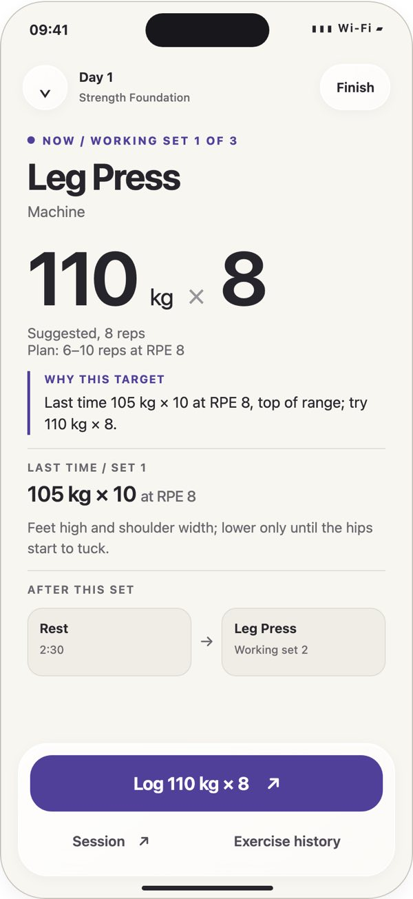
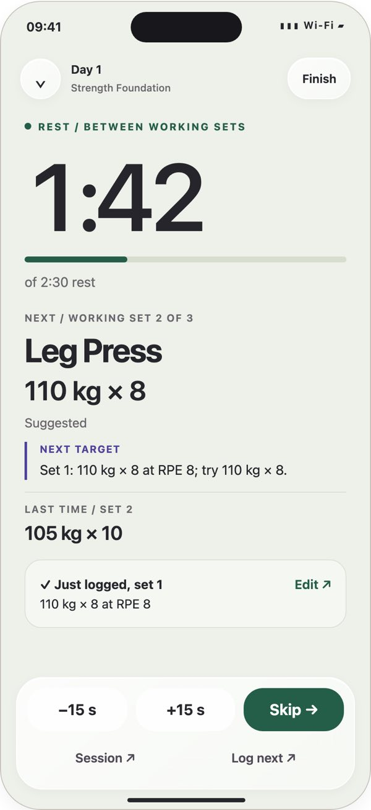
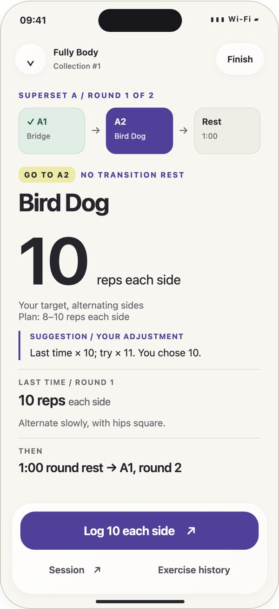
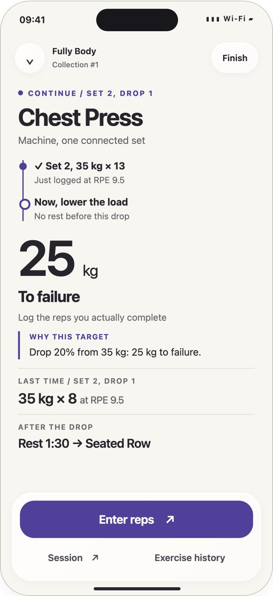
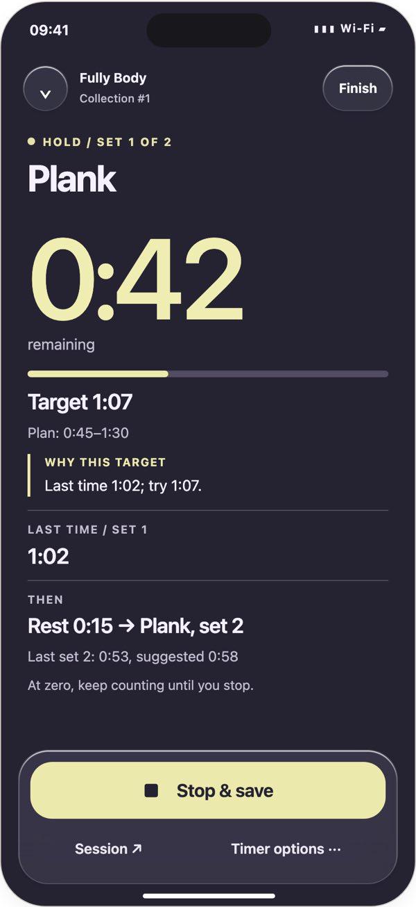
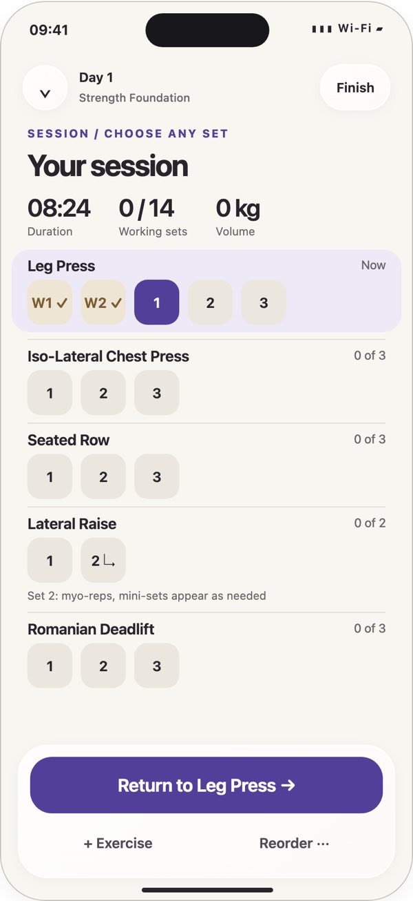
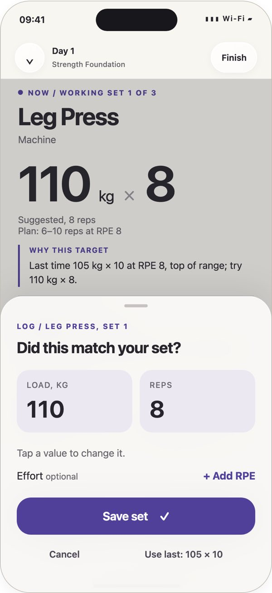
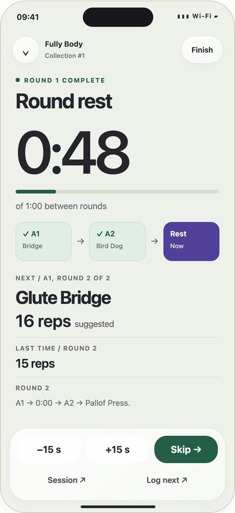
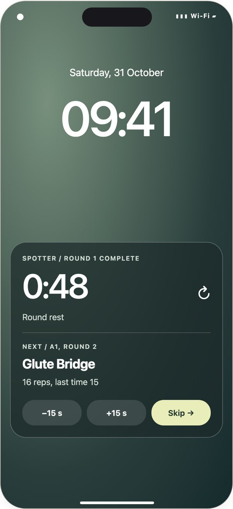
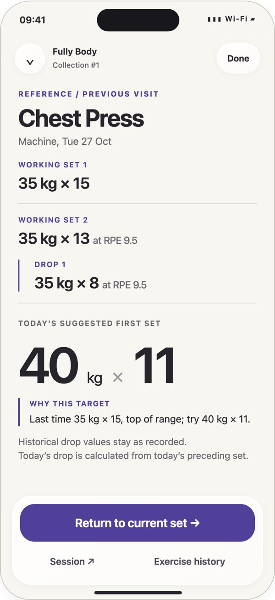

# B. Big type: the rejected large-text concepts

Status: **rejected by the owner, 2026-10-31.** Verdict, verbatim: "not a fan of any of these,
too much large text, hard to make changes to my reps/weight/rpe -- try again".

Asked for on 2026-10-31 after the owner said the first build copied Hevy too closely
("consider inovating a bit more. ask codex astra for help/suggestions"). Codex Astra
developed three directions and recommended the first, with the second's session map:

- **Beat:** one large set instruction becomes the rest countdown after logging. Best for
  floor-distance glances and one-thumb use; comparisons move into the session map.
- **Route:** every set and rest appears along a traversable path. Clearest sequencing and
  editing context, but long sessions demand more scrolling.
- **Bench:** persistent exercise stations combine history, the current target and today's
  receipts. Strong within-exercise context, but switching stations competes with logging
  controls.

The screens below are Beat with Route's session map. Accepting a suggestion takes
Log → Save, with optional RPE. The full write-up, with all eight requested behaviours per
direction, trade-offs, field bindings, new Swift types, gestures and accessibility, is
[`large-text/design-spec.txt`](large-text/design-spec.txt), verbatim.

One set fills the screen in large numbers, with the reason for the suggestion and last time under it. Log opens a tray to confirm or change the values, and Save records the set. The same screen then turns into the rest countdown with what comes next, and a session map shows everything else.

- **Good at:** Readable from a metre away with the phone on the floor, and the rest screen says exactly what is next.
- **Watch for:** A lot of large text, one set at a time, and changing weight, reps or effort goes through the tray, so it takes more taps.

What the rejection taught, and what the next round was told: normal iPhone text sizes with
several sets and exercises on screen; weight, reps and effort changed in place, one tap to
start, one per step, one to log, and no keyboard for ordinary changes. See
[README.md](README.md).

## Screens

### 1. The working set

One instruction, its reason, its exact reference.

### 2. Between sets

Recovery is the primary state; next stays visible.

### 3. Superset in progress

A1 → A2 → round rest. No exercise-card scrolling.

### 4. The drop

A connected follow-up, with actual reps required.

### 5. Timed hold

A floor-readable countdown. Zero does not save.

### 6. The whole session

Day 1 in full. Pick any set; edit any receipt.

### 7. Tap two: save

Optional effort, large edits, no forced question.

### 8. Between rounds

A clear boundary before A1 starts again.

### 9. Lock Screen

The same current state, reduced to its essentials.

### 10. Reference detail

Real Chest Press history, without a spreadsheet.

