# C. Rows

Status: **chosen by the owner, 2026-10-31**, and built: it is the app's default session layout ([DESIGN.md §7.6a](../../../DESIGN.md#76a-the-rows-layout-the-default)). The owner: "start with option c (rows) and let's get it implemented."

A static mockup from the second design round, 2026-10-31, drawn at iPhone Pro Max size
with the owner's real Day 1 plan. The round's brief is in [../README.md](../README.md#the-second-round).

Each set is one line that reads like a sentence, such as “Set 2, 110 kg × 8, last 105 × 10”. The set you are about to do opens in place, with −5/+5 and −1/+1 buttons, a strip of RPE values in half steps, and a Log button that says exactly what it will save. Done sets fold back to one line that shows how they compare with last time.

- **Good at:** The fastest single changes, the clearest “do this now”, and a superset that reads top to bottom in the order you do it.
- **Watch for:** The open editor takes about a third of the screen, and the overall structure is the most familiar of the four.

## Screens

### 1. Leg press, set 2 open

Warm-ups fold into one line. Set 1 reads as a sentence with today against last time. Set 2 is already open: last time sits beside each value, steppers under the thumb, and the target RPE 8 is pre-filled (hollow), so one tap on Log saves all three.

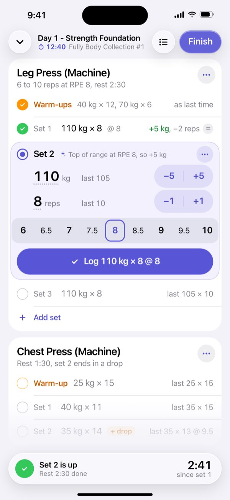

### 2. One rep fewer

One tap on −1. The changed value turns tint, a chip after last time offers the suggested 8 back, and the Log button now says exactly what will be saved.

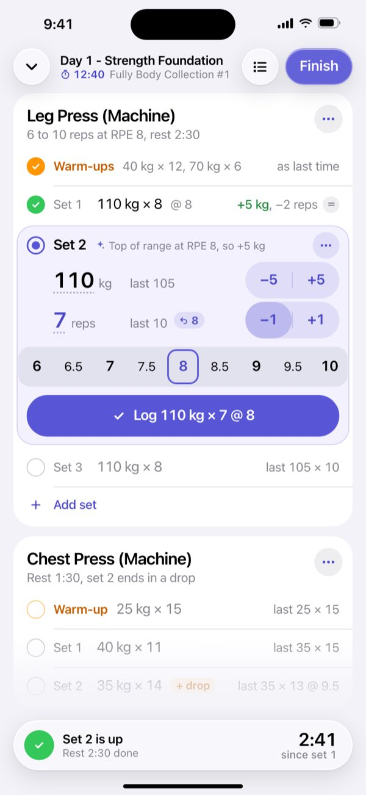

### 3. Superset A, mid-round

Members interleave in the order you do them: A1, then 0:00, A2, rest 1:00, round 2. RPE is off for this accessory, so the editor is one line of steppers and Log (+ RPE adds it back).

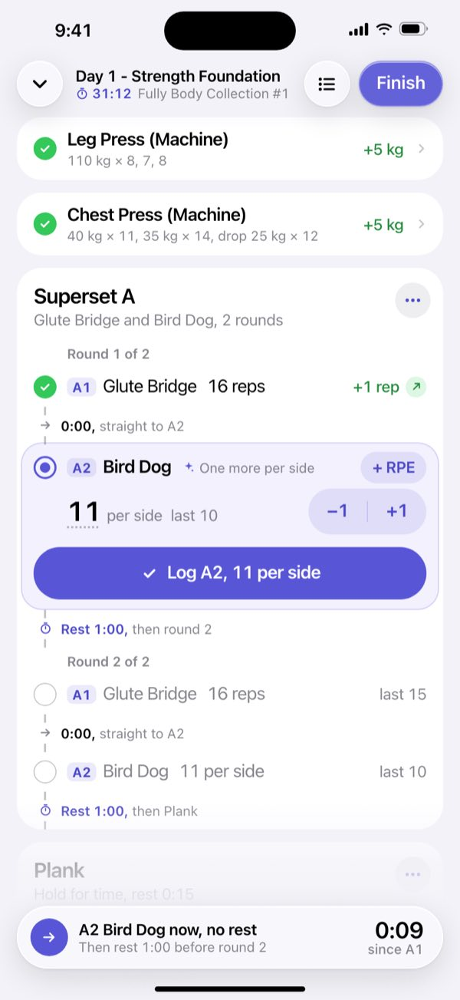

### 4. Resting after set 2

Set 2 closes to one line: the change and an overall verdict (here below last time). Set 3 is open for changes during the rest. The capsule counts down and says what follows set 3.

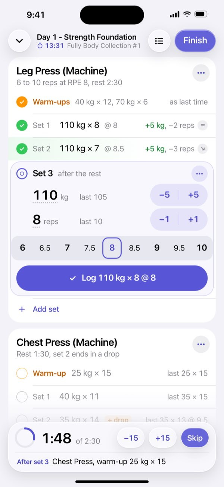

### 5. Chest press drop, running

The drop hangs off set 2 and opens at once, with no rest. RPE 10 is pre-filled because it is to failure, and the reps are an estimate; tap 9.5 if you stopped short.

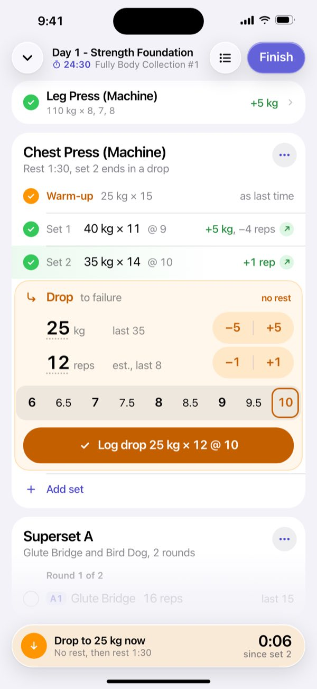

### 6. Plank, timed set running

A timed row swaps steppers for a clock and a track with two ticks: last time (1:02, below) and the goal (1:07, above). Stop logs the hold.

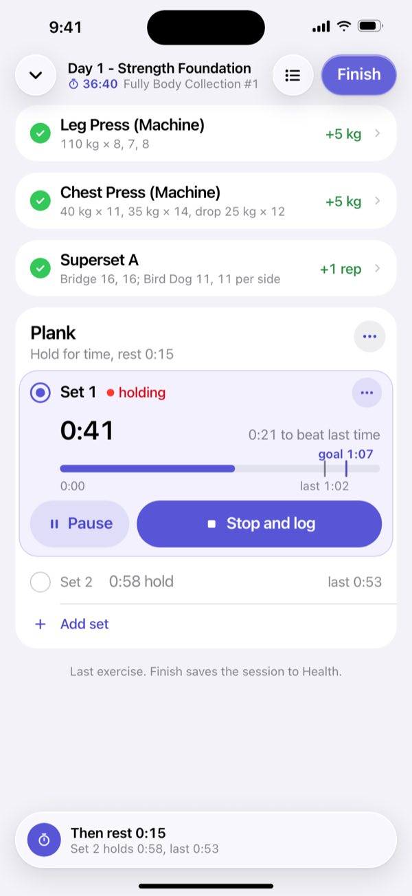

### 7. RPE 8.5 in one tap

Every half step is its own 44 pt cell across the full card. A tap fills the cell; the header line says what the number means for a moment, and the Log label updates.

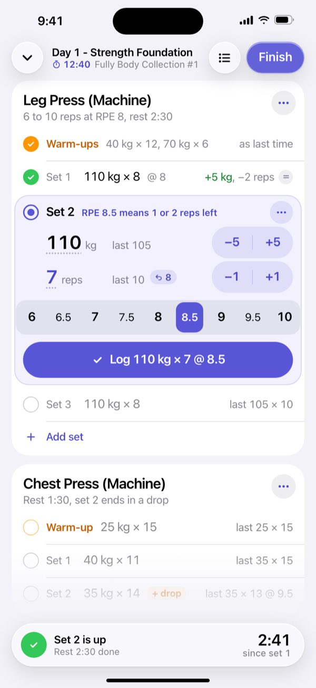

### 8. Fixing set 1

Tap any done row to reopen it in place. Edit mode is neutral, not tint, saves instead of logging, and the chip reads was 8. Set 3 keeps its up next marker and the rest keeps running.

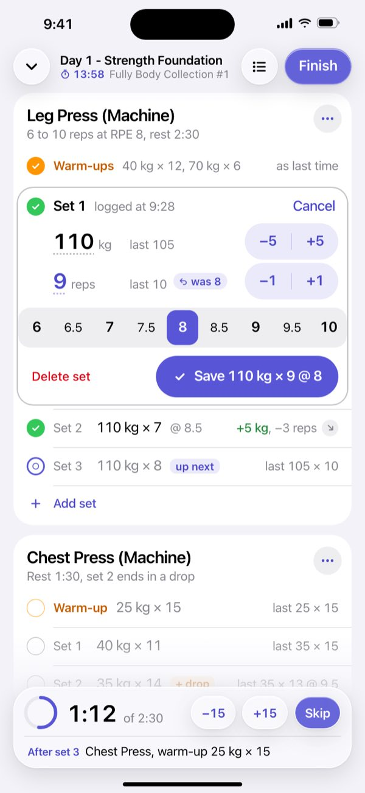

### 9. Out of order

The leg press is taken: tap any later row to do it now. The skipped set waits in place, marked later, and the capsule offers the way back.

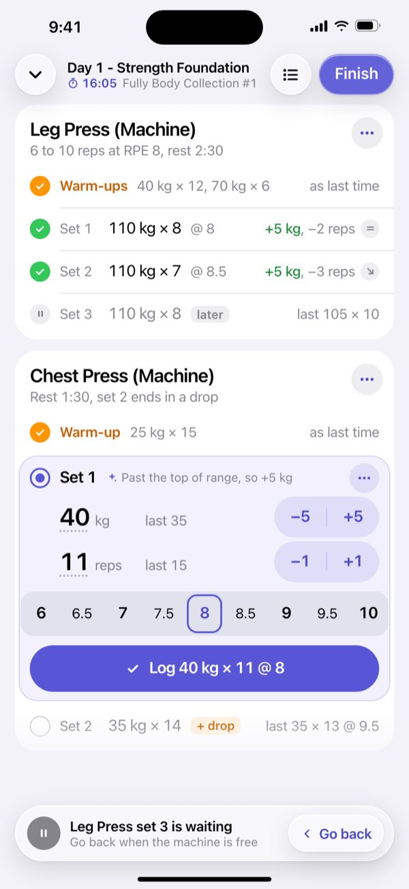

### 10. Myo-reps on set 3

Set 3 switched to myo-reps from its set menu (today's plan has none). Activation is a normal row; mini-sets collect as chips; the editor logs one mini at a time and has a way to end.

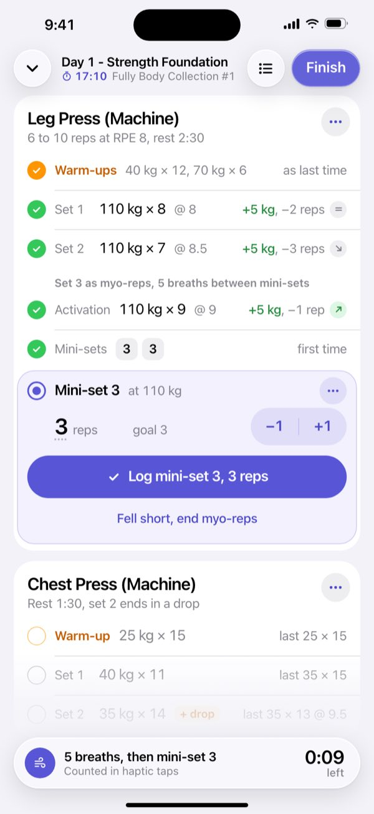

### 11. Big jumps: tap the number

The dotted underline marks a value you can type. A glass keypad opens with the machine's steps; a chip applies at once and closes the pad, typed numbers need Set.

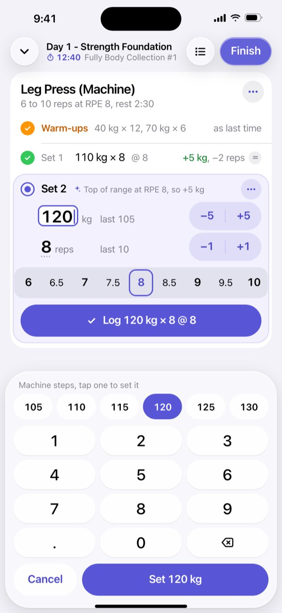

### 12. Warm-up 1, open

Warm-ups use the same editor in orange, with no RPE. Once both are logged they fold into the one-line Warm-ups row seen on screen 1.

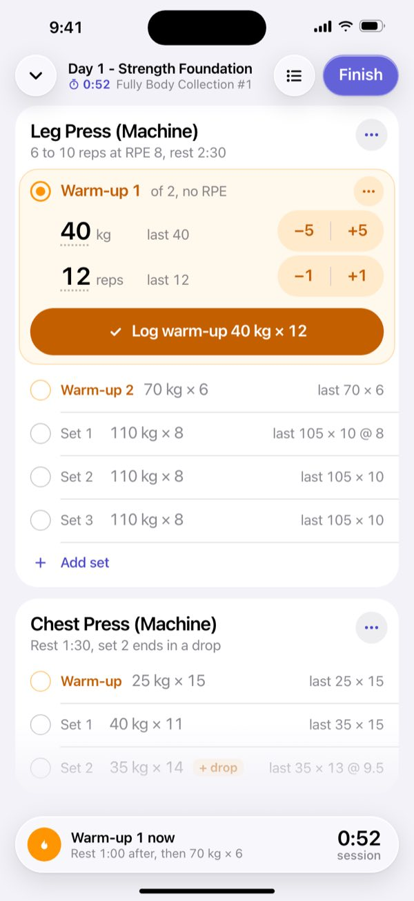

### 13. Dark

Same moment as screen 1 in dark appearance.

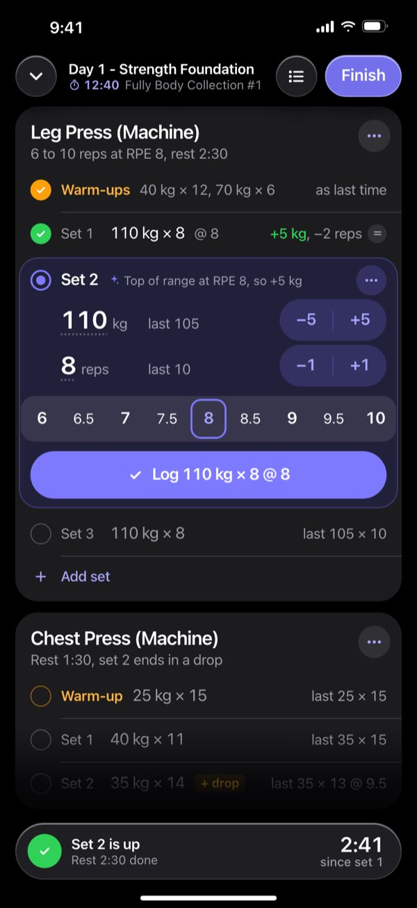

## The designer's rationale

Verbatim from the round's `rows/rationale.md`, written after a critique pass against the
owner's feedback and revised; screen numbers refer to the screens above.

### Spotter in-session: rows (revision 2)

#### The idea

Each set is one line that reads like a sentence: `Set 1  110 kg × 8 @ 8   +5 kg, −2 reps  =`.
There is no column grid and no header row. Only the set you are on is open, in place, as a
compact editor about 260 pt tall:

- a header line with the set name and the reason for today's numbers, in one line;
- the load and the reps, each with last time at a fixed position beside it and a −/+ stepper
  on the right under the thumb;
- a full-width RPE strip with every half step from 6 to 10, where the target is already filled
  in;
- a Log button that says what it will save ("Log 110 kg × 8 @ 8").

When you log, the row closes to one line showing today against last time plus a small verdict
mark, and the next row opens by itself. Upcoming rows are grey and show last time. A finished
exercise shrinks to a one-line summary card.

Supersets list their members in the order you do them, round by round (A1, A2, rest, A1, A2),
with the hand-off and the round rest as thin rows of their own. Liquid Glass is used only on
what floats: the toolbar buttons, the rest capsule and the keypad. Rows, cards and every
control inside them are opaque, with flat tinted or grey fills and no shadows.

Text sizes: edited values 26 pt, the hold and rest timers 28 pt, exercise names 20 pt,
everything else 13 to 17 pt.

#### What changed after the critique

- **RPE is pre-filled.** The target RPE (8 here, 10 for a drop to failure) appears in the strip
  as a hollow outlined cell, and the Log label already includes it. One tap on Log saves load,
  reps and RPE together. Tapping any other cell fills that cell solid and replaces the target.
  You can no longer save a set without an RPE by accident.
- **The editor is about 260 pt instead of 340 pt.** The changes:
  - the RPE header and its "Tap how hard it was" hint are gone;
  - the reason line moved into the header row and lost its last-time figures ("Top of range
    at RPE 8, so +5 kg");
  - field rows are 48 pt.

  Screen 1 now shows the whole leg press and three rows of chest press.
- **The RPE strip runs the full card width.** Cells are 44 × 48 pt. Half steps are 15 pt in the
  primary colour at regular weight, next to 17 pt semibold integers. The selected cell stays the
  same size, and its fill is inset inside the cell, so there is no halo.
- **"last" sits at a fixed position** after the value and unit, so `last 105` and `last 10` line
  up. The reset chip comes after it: `↺ 8` returns to the suggestion, and `↺ was 8` (fix mode)
  returns to what was logged.
- **One unit rule.** A load value always carries kg. A `last` reference never does, because it
  always sits beside a value that shows the unit. Summaries collapse a repeated load
  (`110 kg × 8, 7, 8`). "per side" is used everywhere.
- **One delta rule and a verdict.** Any gain is green and any loss is grey, everywhere. After the
  delta comes a small mark that settles mixed results:
  - green ↗ means better than last time;
  - grey = means about the same (within 1%);
  - grey ↘ means below last time.

  The verdict comes from estimated 1RM, adjusted for RPE when both sessions have it. Set 1,
  110 × 8 @ 8 against 105 × 10 @ 8, is level. Set 2, 110 × 7 against 105 × 10, is below.
- **The rest capsule no longer repeats the open set.** Its second line says what follows: "After
  set 3: Chest Press, warm-up 25 kg × 15". The unclear "Rest" button is gone. When the rest is
  over, the capsule shows "Set 2 is up" and the time since set 1.
- **Plank:** the hint text is gone. The track has two ticks, last 1:02 labelled below and goal
  1:07 labelled above, so the labels never collide.
- **Tags:** "up next" uses the tint colour, "later" is grey, and orange stays for warm-ups and
  drops.
- **Tap affordance:** editable values have a faint dotted underline, meaning tap to type.
- **Superset:** the header's second line is gone. RPE is set per exercise, and it is off for the
  Bird Dog, so that editor is one stepper row and Log. A `+ RPE` chip adds the strip back. Round
  2's A2 now sits clear of the capsule.
- **Glass discipline:** the steppers are tinted fills, like `.bordered` buttons. The RPE strip is
  a grey track (`tertiarySystemFill`). Neither has a shadow. The glass capsule and the bottom
  scroll-edge fade are more opaque, so list text no longer shows through.
- **Keypad chips** run in consecutive 5 kg steps, from 105 to 130. A chip applies the weight at
  once and closes the pad.
- **Coverage:**
  - a new screen shows warm-up 1 open (40 kg × 12, orange, no RPE);
  - myo-reps are now shown on leg press set 3, switched from the set menu, so there is no
    made-up exercise;
  - the Plank shows both sets wherever it appears.

#### Tap counts (from the moment the set is due)

The current set is already open, so starting an edit costs no tap.

| Action | Taps | How |
| --- | --- | --- |
| (a) Accept the suggestion and log, RPE included | **1** | Log ("Log 110 kg × 8 @ 8") |
| (b) One rep fewer, then log | **2** | −1, Log |
| (c) One load step up, then log | **2** | +5, Log |
| (d) Set RPE 8.5 | **1** | tap the 8.5 cell (2 counting Log) |
| (e) Fix a set done earlier (one-step change) | **3** | tap the done row, −1/+1 or an RPE cell, Save |
| Do a later set first (out of order) | 1 | tap its row; it opens and becomes current |
| Big jump (110 to 120) | 3 | tap the number, tap the 120 chip (applies and closes), Log |

Extras that cost nothing to ignore:

- Holding a stepper repeats it.
- Each step and each RPE cell gives a haptic tick.
- Dragging along the RPE strip scrubs through the values.
- An undo toast stays up for 5 s after every log.

#### How a lifter reads it

**What now.** Look for the one tinted panel; nothing else is open. Its Log button names the exact
set, RPE included. From across the bench, the glass capsule at the bottom says it in words:

- "Set 2 is up";
- "A2 Bird Dog now, no rest";
- "Drop to 25 kg now";
- "5 breaths, then mini-set 3";
- or the rest countdown, with what follows.

**Last time.** It is on every row, in the same place:

- Upcoming rows end with `last 105 × 10` (with `@ 9.5` when last time had an RPE).
- In the open editor, `last 105` sits next to the load and `last 10` next to the reps, at the
  same x, so you compare one number with one number.
- Once a set is done, last time becomes the difference (`+5 kg, −2 reps`) plus the verdict mark.
- Summary cards carry the headline change (`+5 kg`).

**RPE.** The outlined cell is what will be saved if you do nothing. A tap fills a cell, and for a
moment the header line says what it means ("RPE 8.5 means 1 or 2 reps left").

#### The screens

1. **Set 2 open:** the warm-ups are folded into one line, and set 1 is done with its verdict
   (level). Set 2 is open with RPE 8 pre-filled.
2. **One rep fewer:** after −1, the value turns tint, a `↺ 8` chip appears after `last 10`, and
   the Log label updates.
3. **Superset:** rows are interleaved by round. A2 is an RPE-off editor, so it is short, and
   round 2 is fully visible.
4. **Resting:** set 2 has closed with "+5 kg, −3 reps ↘". Set 3 is open for changes during the
   rest. The capsule says what comes after set 3.
5. **Chest press drop:** it hangs off set 2 and opens at once with no rest. RPE 10 is pre-filled
   and the reps are an estimate ("est., last 8").
6. **Plank:** a clock, and a track with two ticks: goal above, last below.
7. **RPE 8.5:** one tap fills the cell, and the header briefly explains it.
8. **Fixing set 1:** the editor is neutral, with a `was 8` chip and Save, Cancel and Delete. Set 3
   keeps its tinted "up next" tag and the rest keeps running.
9. **Out of order:** chest press set 1 is open. Leg press set 3 waits with a grey "later" tag,
   and the capsule offers Go back.
10. **Myo-reps on leg press set 3:** the activation row comes first, then mini-sets as chips, then
    an editor for one mini at a time with "Fell short, end myo-reps".
11. **Keypad:** consecutive machine steps as chips, with a typed value shown in a box.
12. **Warm-up 1 open:** the same editor in orange, with no RPE strip. The rest of the plan shows
    below with last time.
13. **Dark:** the same moment as screen 1.

#### What is new compared with Hevy

- **Sentences instead of a grid.** There are no SET / PREVIOUS / KG / REPS / RPE / ✓ columns
  and no header row.
- **Already open, already filled.** In Hevy you tap a small box, the keyboard comes up, you type
  and then tick. Here the suggestion and the target RPE are already in place, and one tap logs
  them.
- **Steppers show their step** (−5/+5, −1/+1) and sit under the right thumb.
- **RPE in the row.** All nine values are 44 pt cells in one strip. Hevy uses a sheet with a
  picker and a separate confirm.
- **A self-describing Log button.** You see what will be saved before you save it.
- **Done rows show the change and a verdict.** You do not subtract a "previous" column in your
  head, and mixed results such as +5 kg, −2 reps get a clear better, same or below.
- **Supersets in doing order,** with the transition and round rest as explicit rows.
- **Drop sets attached** to their parent set, opening at once.
- **Finished exercises shrink to one line.**
- **Fixing and skipping in place,** with the way back offered in the capsule.

#### Risks

- **A pre-filled RPE can be logged without thought.** The record should keep a flag for "assumed,
  not tapped", so progression logic can weigh it less. Whether done rows should show it
  differently needs testing; showing it differently adds visual noise.
- **One-tap logging invites logging the target instead of what you did.** The Log label and the
  5 s undo reduce this; they do not remove it.
- **The verdict mark is a model, not a fact.** An e1RM comparison across rep ranges is rough, and
  it says "below" for a planned move to heavier, lower-rep work. It is shown in grey, never red,
  so it does not read as failure.
- **The editor is still about 260 pt.** On a mini or SE that is a third of the screen. Showing the
  reason line only on set 1 and hiding the strip for RPE-off exercises keeps it workable.
- **RPE cells are exactly 44 pt.** With wet thumbs a miss lands on a neighbouring half step. That
  is cheap to fix and visible at once in the cell and the Log label. Scrubbing helps.
- **Fixed steps** (5 kg) do not suit machines with 2.5 kg add-ons. The step is set per exercise,
  and the keypad covers the rest.
- **Steppers on the right favour right thumbs.** Left-handers need a mirror setting.
- **Auto-scroll after Log can disorient.** It should scroll only after Log and never while a
  finger is down.
- **Large Dynamic Type sizes** wrap the sentence rows and the header reason line. At accessibility
  sizes the reason should drop to its own line, and the strip may need two rows.
- **Dotted underlines** may read as links or spelling marks to some people. A pressed state on
  touch-down should back them up.

#### Build notes

- `index.html` is generated by `build.py` (`python3 build.py`); run it after any change.
- Rendered PNGs are in `png/`. The renders the critique used are in `critique-png/`.
- In SwiftUI this maps to:
  - a `List` of custom rows;
  - the capsule in `safeAreaInset(edge: .bottom)` with `.glassEffect()`;
  - `.buttonStyle(.glassProminent)` for Finish;
  - `.bordered` tinted steppers;
  - a custom RPE strip with `.sensoryFeedback(.selection, trigger:)`;
  - opaque `secondarySystemGroupedBackground` cards.
