# A. Table: the first build's session screen

Status: **the first build's layout (Spotter V1, 2026-10-30).** Still in the app as the
second layout, **Table** (Settings > Session > Layout, or the session's More menu); Rows
replaced it as the default on 2026-10-31.

The app as it works now, close to Hevy and Strong. Each exercise is a card with a table of sets: previous, weight, reps, RPE and a tick. Suggested values are shown greyed in the fields and one tap on the tick logs them. Changing a value opens the number keypad, with − and + steps above it.

- **Good at:** Familiar, dense, and every value is visible at once.
- **Watch for:** Changing a value means the keypad, it reads like a spreadsheet, and the set to do now is only a thin highlight.

The owner's verdict, 2026-10-31: "you've copy pasted too much from the hevy screenshots,
consider inovating a bit more." That started the redesign in [large-text.md](large-text.md)
and then the four options in [README.md](README.md).

These are screenshots of the running app on the iPhone 18 Pro Max simulator (iOS 27),
taken for geoah/rxtx.dev#113 after its simulator and Codex Astra UI-review fixes
([the review](../reviews/ui-2026-10-31-astra.md)). Demo history comes from
[`sessions.yaml`](../examples/sessions.yaml).

## Screens

### 1. Routines

The Routines tab: the owner's folder of four routines, each card listing its exercises.

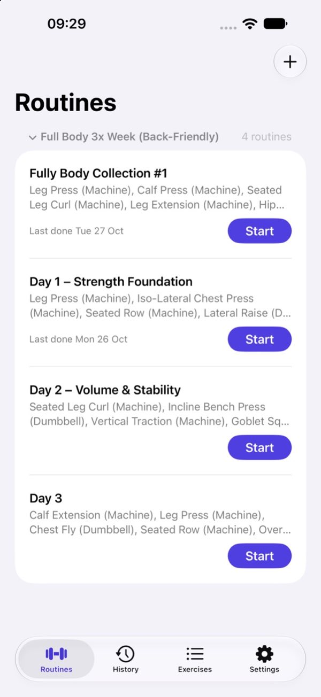

### 2. Routine preview

A routine before it starts, with Start routine at the bottom (the tab bar now hides here, a fix from the Codex review).

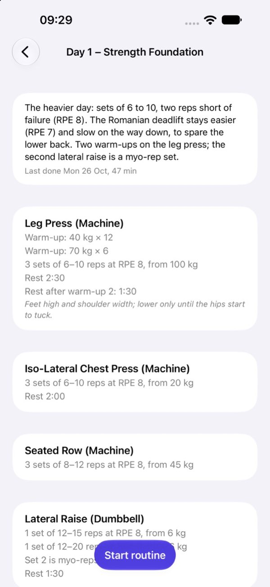

### 3. Session

Each exercise is a card with a table: set, previous, weight, reps, RPE and a tick. Grey values are the suggestion; the tick logs them.

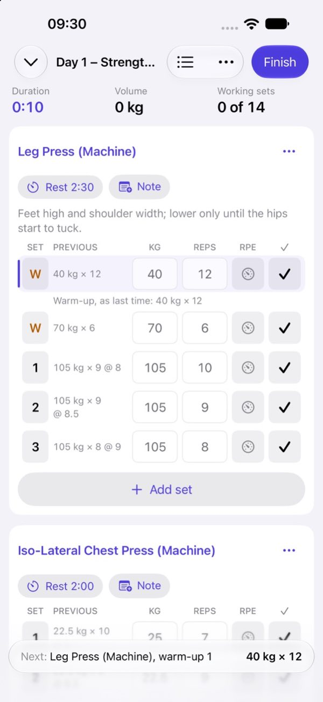

### 4. Resting

After a tick, a rest countdown floats at the bottom with −15, +15 and Skip, and the next set's values beside it.

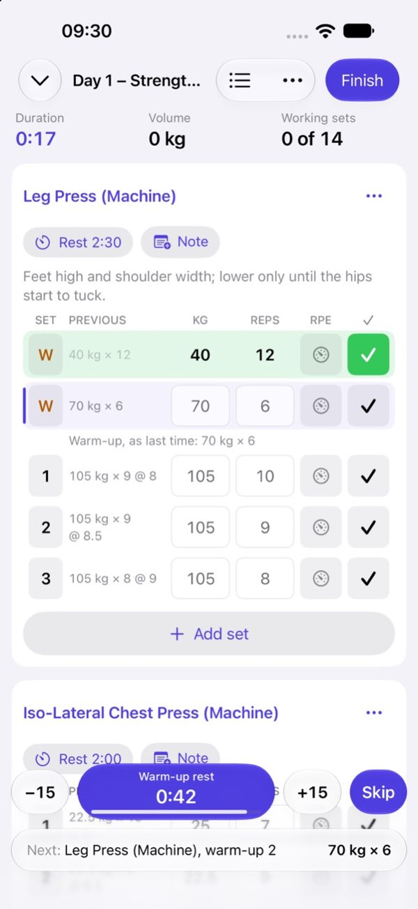

### 5. Rating effort

The RPE button opens a sheet with a slider and half steps, plus −15/+15 and Skip for the running rest.

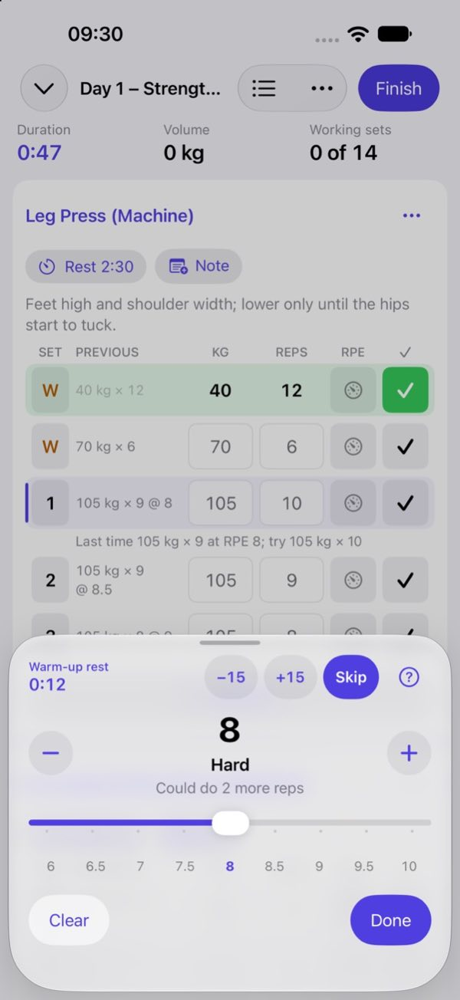

### 6. Finish

The Finish sheet: unticked sets, the start and end, an optional session RPE, and the summary that Save writes.

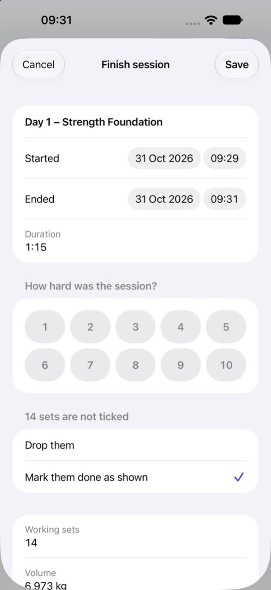

### 7. History

Finished sessions, newest first.

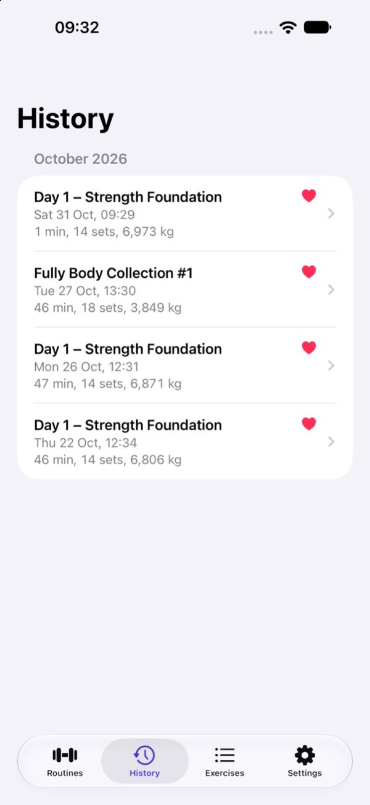

### 8. Session detail

One finished session, exercise by exercise.

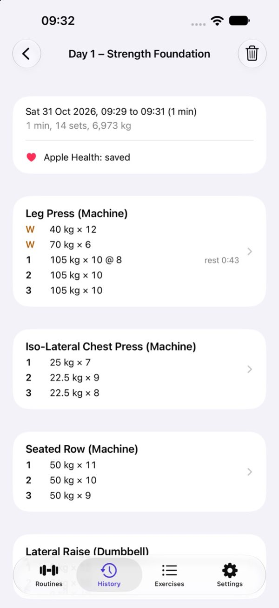

### 9. Next session

The next time, the suggestions move on: 110 kg × 8 after 105 kg × 10 at RPE 8.

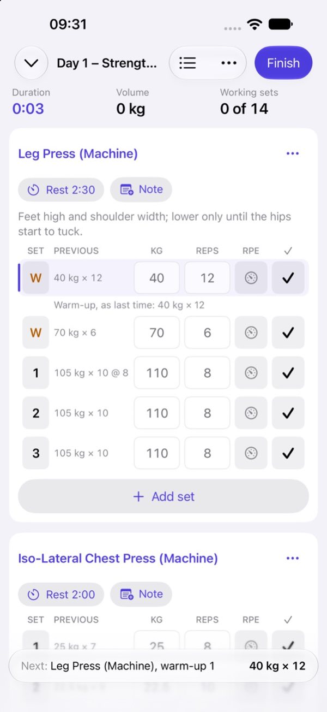

### 10. Exercise and e1RM

One exercise's history and its estimated one-rep maximum trend.

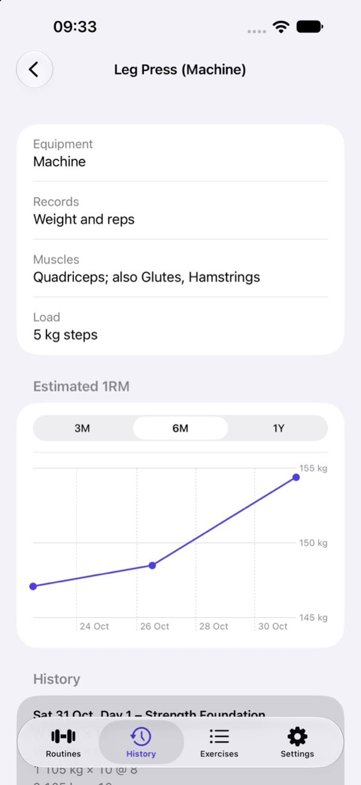

### 11. Timed plank

A timed set counts down from the suggested time with a Stop button, then counts on past it.

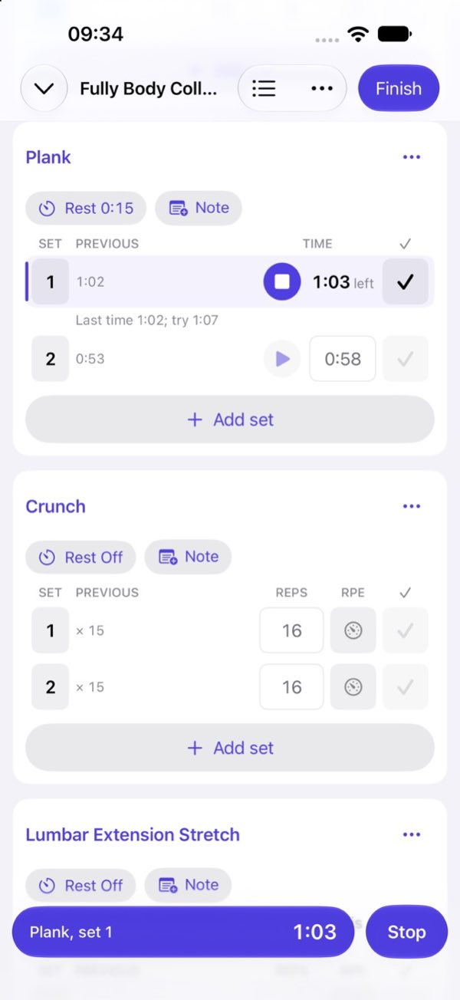

### 12. Set types

A help sheet explains warm-up, working, failure, drop set and myo-reps.

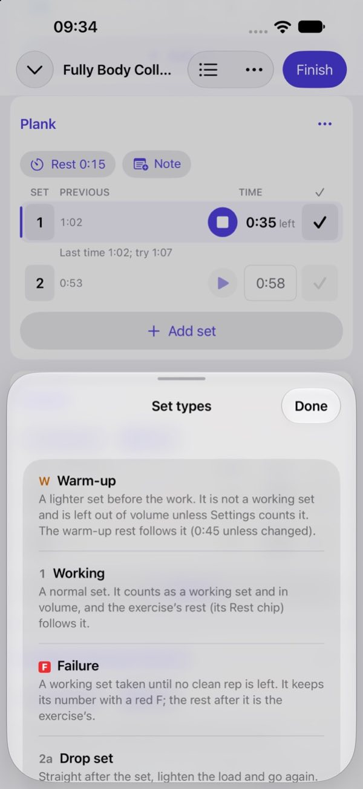

### 13. Suggestions

Today's suggested weight and reps sit in the fields, worked out from last time, with a one-line reason under the set to do now.

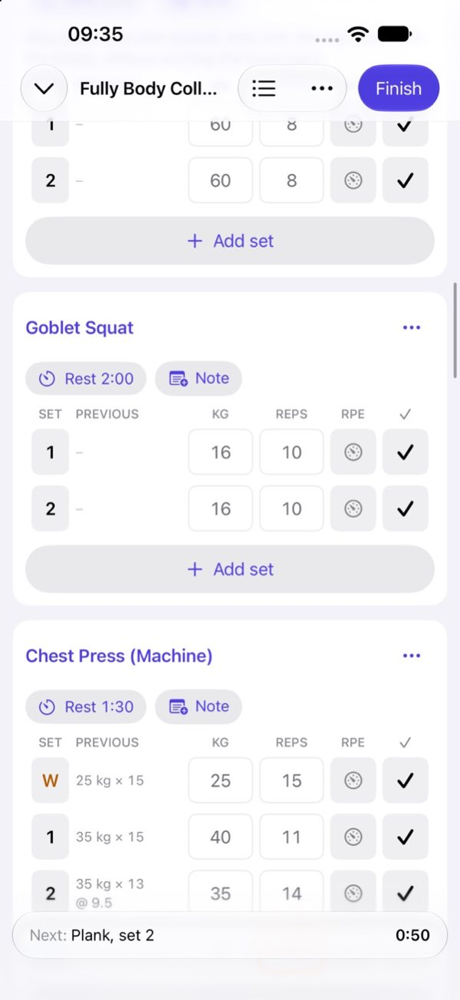

### 14. Superset

The two exercises are stacked in a bracket labelled A1 and A2, with the 0:00 switch and the 1:00 round rest on their chips.

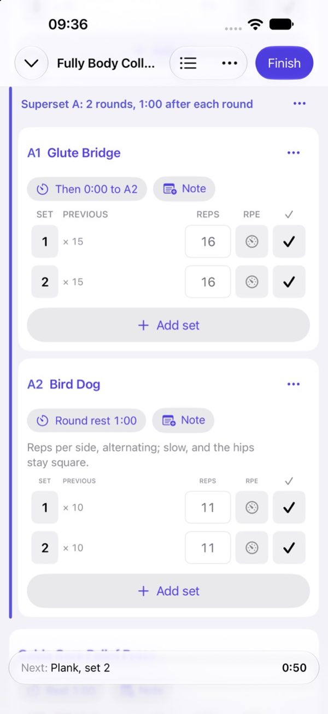

### 15. Dark appearance

The superset in dark mode.

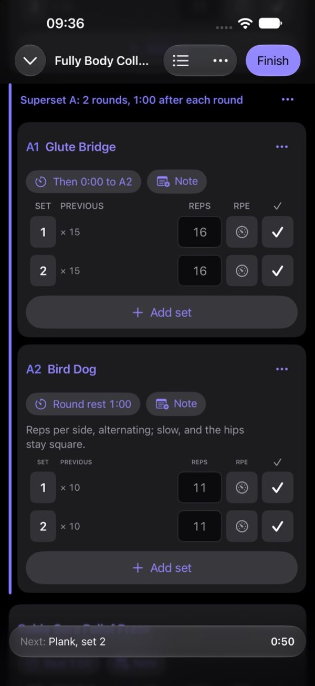

### 16. Straight to A2

After A1, a green bar says to go straight to A2 instead of starting a rest.

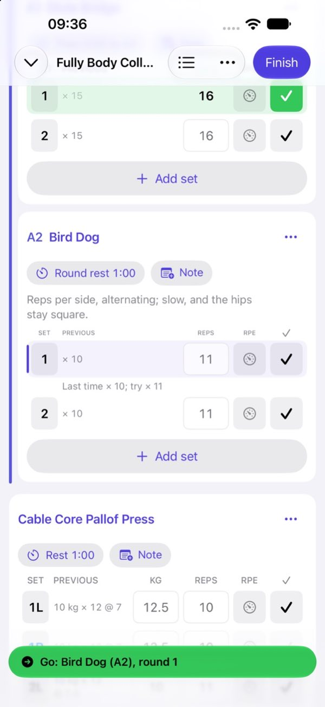

### 17. Round rest

After A2, the 1:00 round rest runs before round 2.

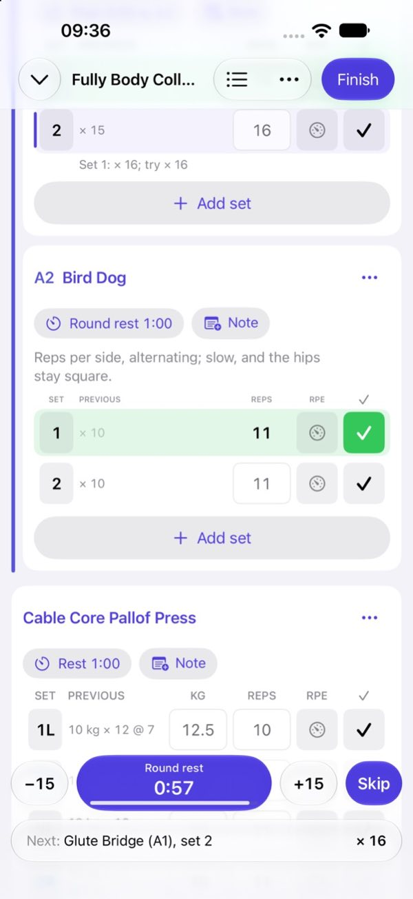

### 18. Lock Screen

The rest timer on the Lock Screen with what comes next.

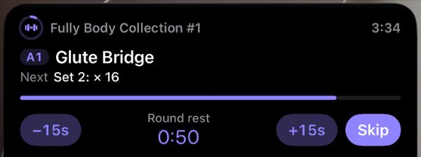
