# The gallery, a sample

Eight of the screens `mise run apps:gallery` draws, each from one fixture
and twice: with SwiftUI in `apple/` and with Compose in `android/`, under the
same name. Six are the kit's shared screens (`ScreenFixtures` in
SubstrateScreens), two are Substrate Tasks' own (`TasksFixtures` in
TasksKit). Both sides draw the same presentation, so the facts, labels,
order and states match while each looks like its own system
([docs/plans/app-kit.md](../../../../docs/plans/app-kit.md), §4 and §7.4).
The hosts are the fixtures' own, `ada.example.com`.

| Name | What it shows |
| --- | --- |
| `status-refused` | the Status screen with a write the server refused: its kind and record id as labelled facts, Retry and Discard |
| `settings` | a Settings screen as an app composes it with `SettingsPresenter.screen`: the app's own section (Tasks' words), then Your Substrate, Repository and Approved access |
| `connect-found` | the Connect screen once the server is found, before the browser sign-in |
| `review-update` | the review of an update that asks for more access and a newer package |
| `repository` | the Repository screen: the server, the repository, the approved access, Change Access and Sign Out |
| `about` | the About screen: the build's version and channel, Check for Updates |
| `tasks-list` | a Tasks list on a phone: its open tasks and quick add |
| `tasks-detail` | a task on a phone, each fact once, List and Priority as the choices that change them |

| SwiftUI | Compose |
| --- | --- |
| 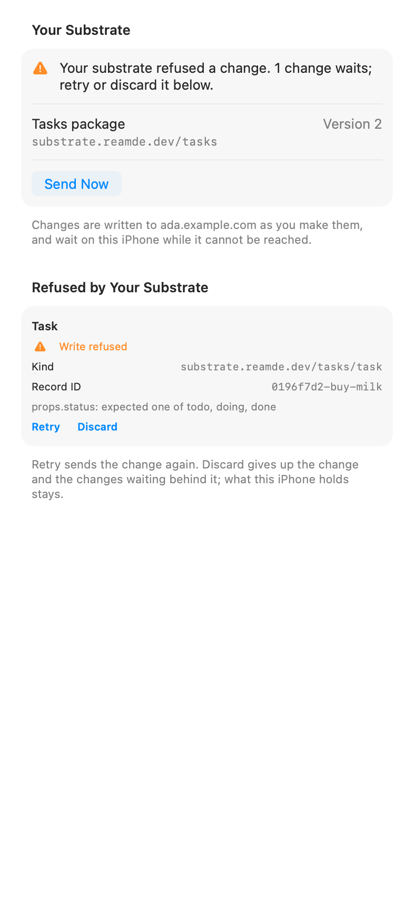 | 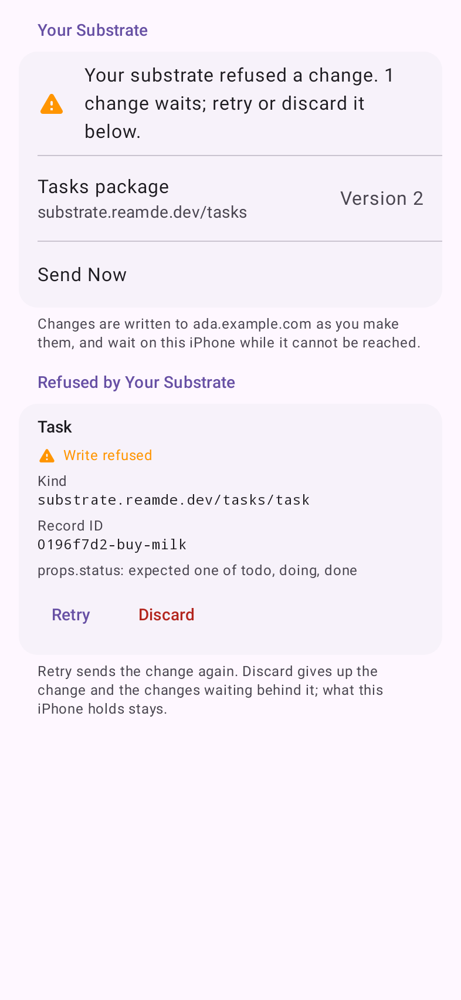 |
| 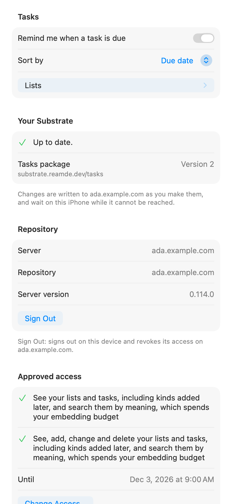 | 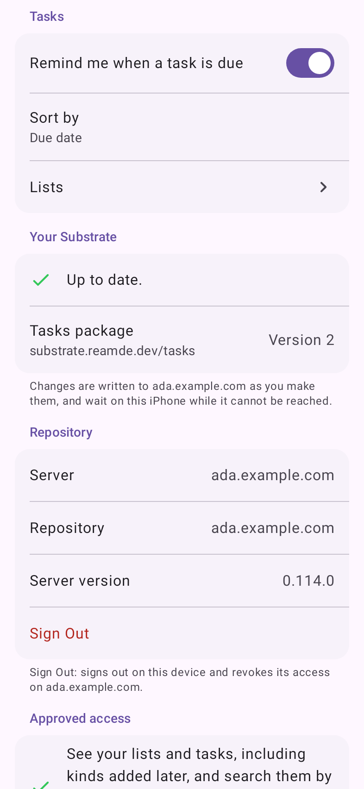 |
| 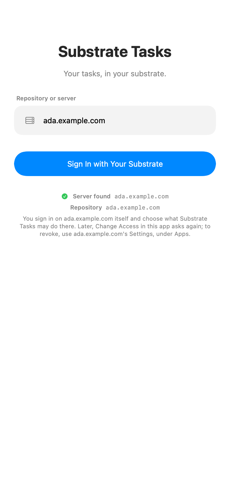 | 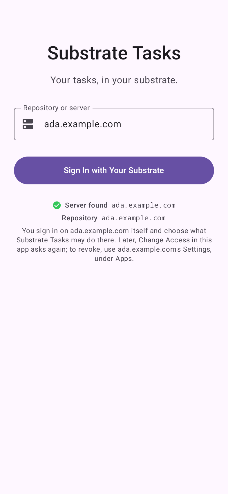 |
| 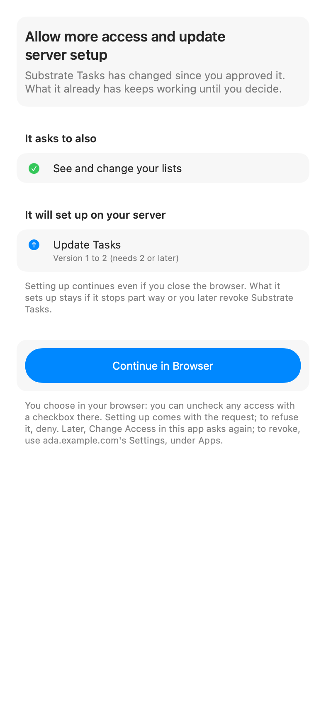 | 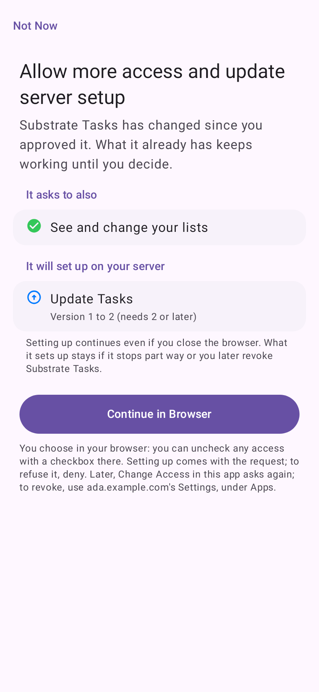 |
| 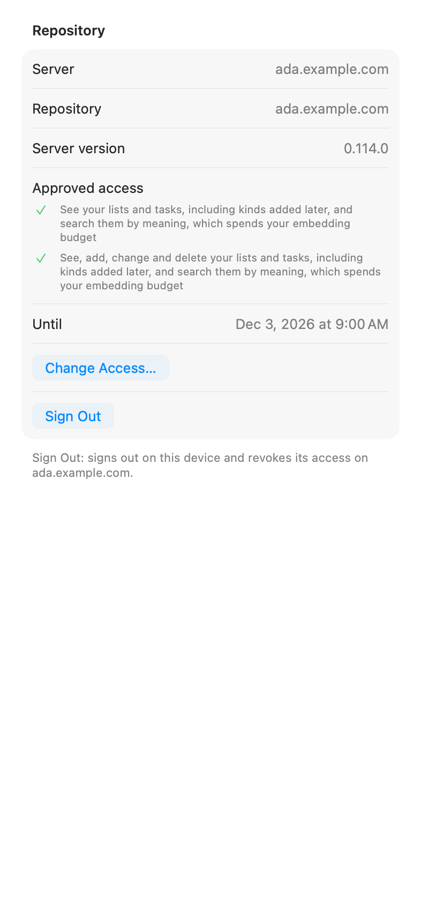 | 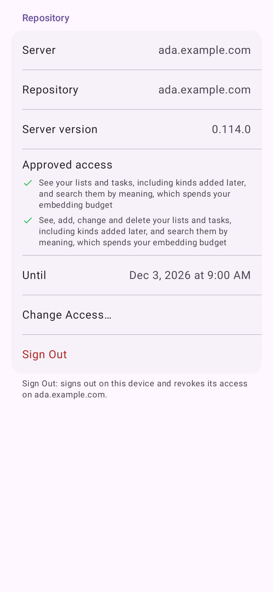 |
| 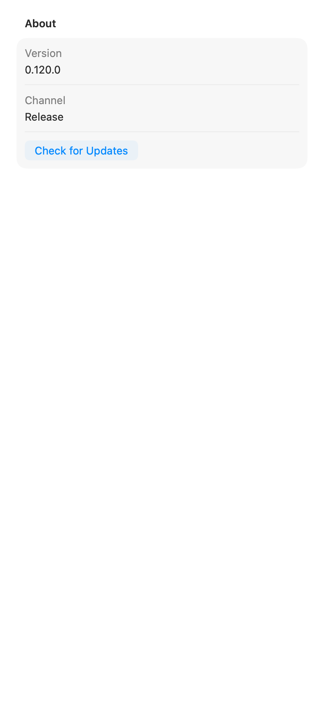 | 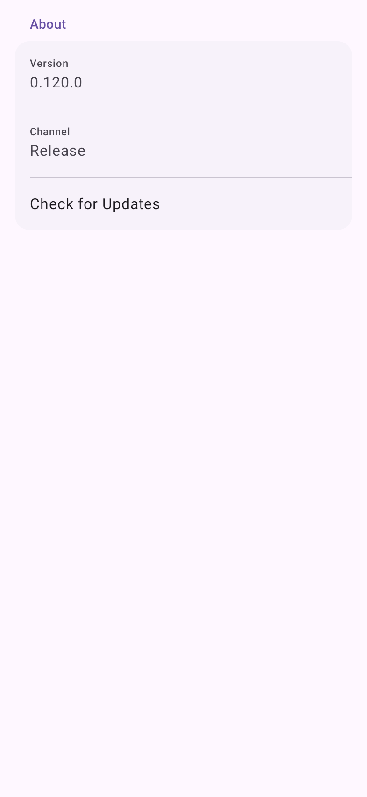 |
| 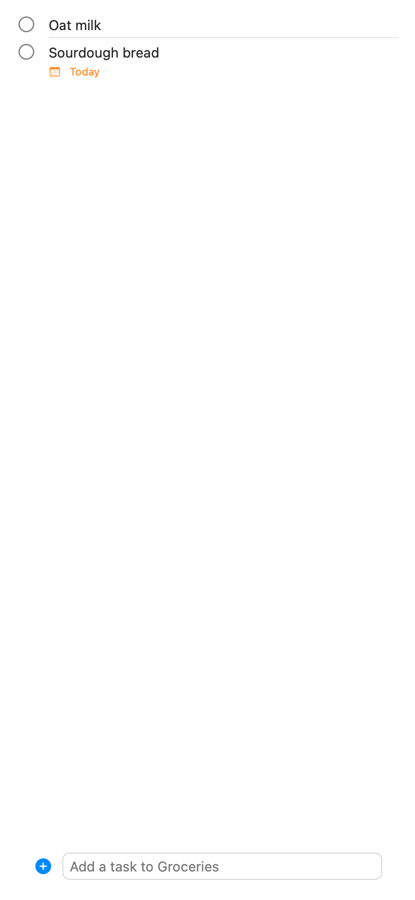 | 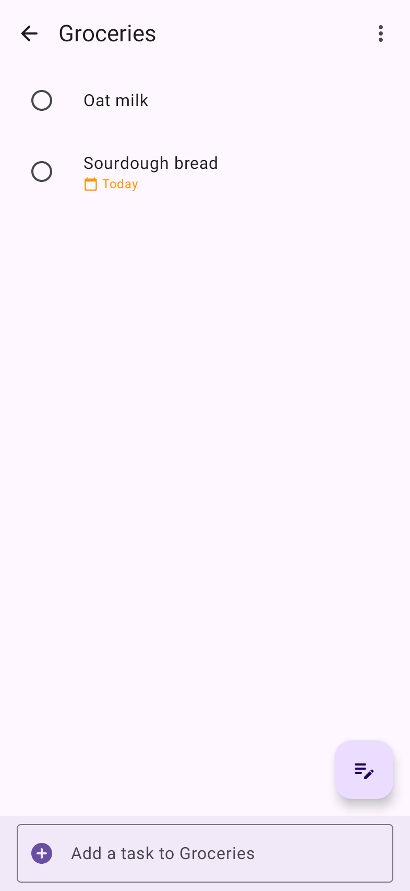 |
| 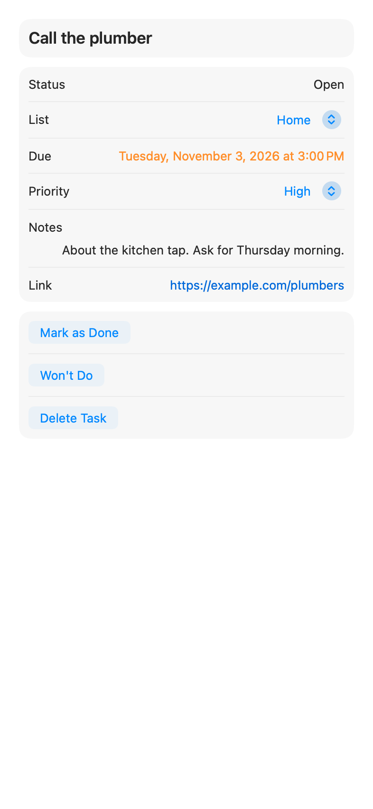 | 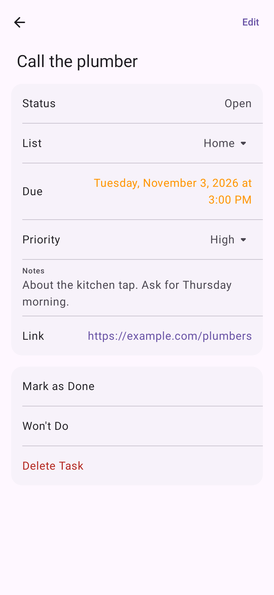 |

The SwiftUI pictures are drawn offscreen on a Mac, which draws an on switch
grey where a device shows the accent (`settings`).

## Drawing them again

```bash
mise run apps:gallery   # every fixture, both systems, into build/gallery/, with index.html side by side
```

The kit's screens land in `build/gallery/{apple,android}/<name>.png` and
Tasks' in `build/gallery/{apple,android}/tasks/<name>.png`; copy the eight
above over these after a presentation or a renderer changes. The full set
stays in `build/`, which is not committed: the gallery is a check, and these
are its sample.
