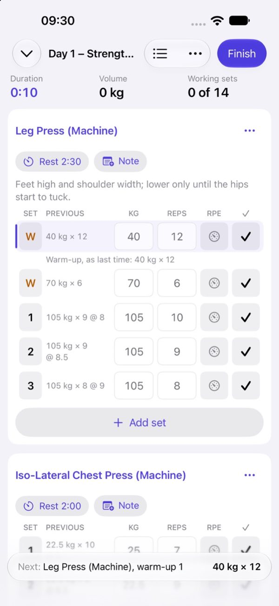
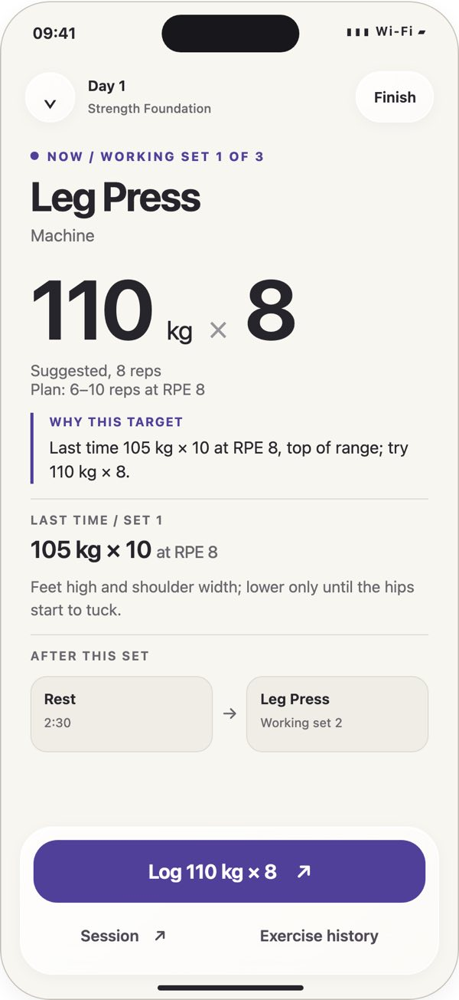
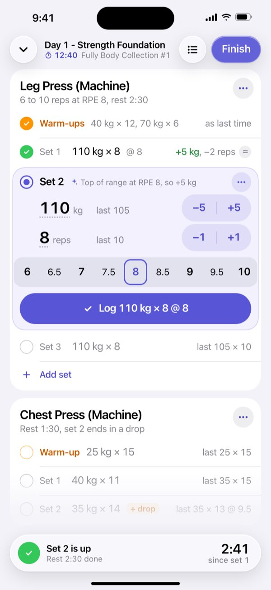
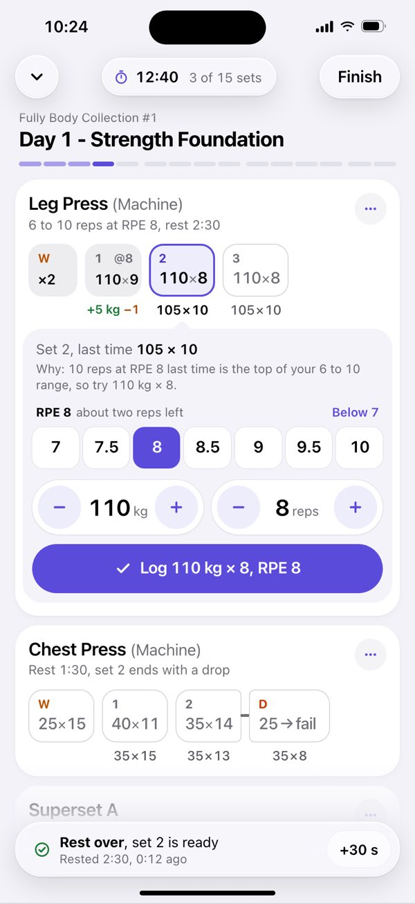
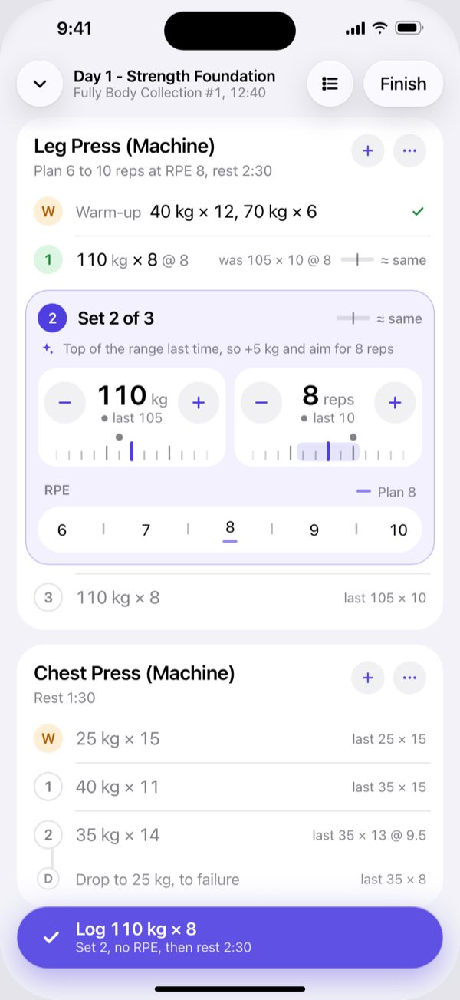
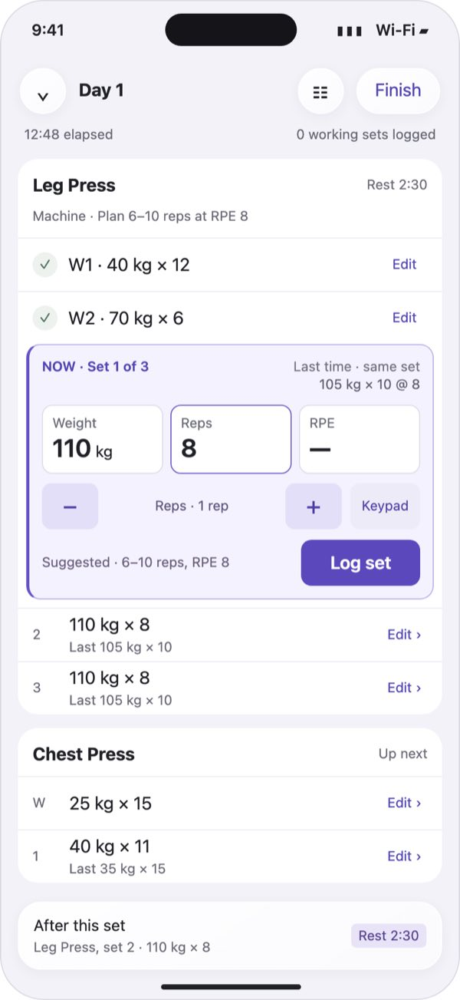

# The session screen: options and how Rows was chosen

The session screen is the one the owner looks at between sets. It went through six designs
in two days. One was built first, one was rejected, and four were drawn in a second round;
the owner picked Rows, which is now the app's default layout
([DESIGN.md §7.6a](../../DESIGN.md#76a-the-rows-layout-the-default)). Each design has a page
with its screens and its rationale:

| Option                                    | What it is                                                         | Outcome                                       |
| ----------------------------------------- | ------------------------------------------------------------------ | --------------------------------------------- |
| [A. Table](table.md)                      | The first build: a Hevy-like table of sets per exercise            | Built 2026-10-30; still the second layout     |
| [B. Big type](large-text.md)              | Codex Astra's first redesign: one set in large type, then the rest | Rejected by the owner, 2026-10-31             |
| [C. Rows](rows/README.md)                 | Each set one line; the set to do now opens in place                | **Chosen** by the owner, 2026-10-31, and built |
| [D. Chips](chips/README.md)               | Sets as chips, with one drawer under the current chip              | Not chosen                                    |
| [E. Direct](direct/README.md)             | The numbers are the controls: dials, a ruler, an RPE strip         | Not chosen                                    |
| [F. Set list](codex/README.md)            | Codex Astra's second-round concept: sets as short receipts         | Not chosen                                    |

Who decided what, and the owner's words, are in [decisions.md](../decisions.md#the-session-screen).

## How it went

- **2026-10-30, A.** The first build's session screen followed the owner's 13 Hevy
  screenshots closely ([research 06](../research/06-app-teardown.md)).
- **2026-10-31, morning.** The owner asked for a UI/UX review by Codex Astra. Its findings
  were fixed in the Table
  ([reviews/ui-2026-10-31-astra.md](../reviews/ui-2026-10-31-astra.md)).
- **2026-10-31, 11:04.** The owner: "I'd be interested to see an alternative more intuitive
  ui for the current sets/supersets that shows in a nicer way what I should be doing,
  previous things etc. you've copy pasted too much from the hevy screenshots, consider
  inovating a bit more. ask codex astra for help/suggestions."
- **2026-10-31, 11:14, B.** Codex Astra proposed three directions and recommended "Beat with
  Route's session map".
- **2026-10-31, 11:20.** The owner: "not a fan of any of these, too much large text, hard to
  make changes to my reps/weight/rpe -- try again".
- **2026-10-31, about 12:00, C to F.** The second round. Three concepts were developed
  independently, each critiqued against the owner's feedback and revised: Rows, Chips and
  Direct. Codex Astra drew a fourth, the Set list.
- **2026-10-31, 12:09 to 14:00.** The owner asked for a page with the options "so I can give
  it to a friend", then for the original and the rejected design to be added as options
  ([the comparison page](#the-comparison-page)).
- **2026-10-31, 15:09.** The owner: "let's get fable and astra to review the data model …
  then start with option c (rows) and let's get it implemented." Rows was built that
  evening, as the default, with the Table kept as a second layout (the private repository's #118).

## The second round

What C to F were asked to do, after B was rejected (from the comparison page):

- Use normal iPhone text sizes and show several sets and exercises at once.
- Change weight, reps and effort in place: one tap to start, one tap per step, one tap to
  log. No pop-up keyboard for ordinary changes.
- Make the set to do now obvious, with what you did last time right beside it.
- Show supersets in the order you do them, with the short switch between exercises and the
  rest after each round.
- Handle warm-ups, drop sets, myo-reps, timed holds like a plank, doing sets out of order,
  and fixing a set done earlier.

## Taps for everyday changes

Counted from the set you are about to do, as the comparison page gave them.

| Task                                 | A. Table | B. Big type | C. Rows | D. Chips | E. Direct | F. Set list |
| ------------------------------------ | -------- | ----------- | ------- | -------- | --------- | ----------- |
| Take the suggestion and log          | 1        | 2           | 1       | 1        | 1         | 1           |
| One rep fewer, then log              | 3        | 4           | 2       | 2        | 2         | 3           |
| One weight step up (+5 kg), then log | 3        | 4           | 2       | 2        | 2         | 3           |
| Set RPE 8.5                          | 3        | 3           | 1       | 1        | 1         | 2           |
| Fix a set done earlier               | 3        | 4           | 3       | 3        | 3         | 2 to 3      |

## The key screens

| A. Table                                      | B. Big type                                        | C. Rows                                         |
| --------------------------------------------- | -------------------------------------------------- | ----------------------------------------------- |
|  |  |  |

| D. Chips                                       | E. Direct                                        | F. Set list                                     |
| ---------------------------------------------- | ------------------------------------------------ | ----------------------------------------------- |
|  |  |  |

## The RPE pre-fill

The comparison page ended with one open question. C and D fill in the planned effort (RPE 8)
in advance, so a single tap logs the set with RPE 8, at the risk of logging an effort nobody
thought about. The others leave effort blank until a value is picked: more honest, but one
more tap on sets worth rating.

Choosing Rows chose the pre-fill. The data-model review made it safe: a pre-filled value is
stored as `rpeMethod: prefilled`, and suggestions, PRs and exports read it as no rating
([decisions.md, U6](../decisions.md#u6-rows-fills-in-the-planned-rpe-and-the-record-says-so)).

## The comparison page

The owner asked for the options on one page to share with a friend. It was published
on a private page, which is not linked here.
Published pages cannot be edited, so this is the second version, with A and B added. It is
self-contained (4.9 MB, its images inlined) and titled "Spotter: six options for the workout
screen". For each option it gives the idea, what it does well, what to watch for and all its
screens with captions, followed by the tap table above, the open question and a glossary.
The page is not in this repository; the pages here carry the same screens, captions and
verdicts.

## Hevy, the reference the owner moved away from

The first build's inspiration was the 13 screenshots of Hevy the owner attached on 2026-10-30:
the routines, a session with timed, warm-up and drop sets, a superset, the rest timer, the RPE
keypad, the set-type sheet, the Live Activity and the Apple Watch's rest countdown.
[Research 06](../research/06-app-teardown.md#1-the-hevy-screenshots-screen-by-screen) reads
them screen by screen. On
2026-10-31 the owner asked to move away from them ("you've copy pasted too much from the hevy
screenshots"). The screenshots are not in this repository: they are another company's app
showing the owner's own training. The research describes what they show.

## What is not here

- The mockups' HTML, their build scripts (`build.py`, `build.mjs`, `render.mjs`) and the
  comparison page's builder. They drew the PNGs these JPEGs come from, and nothing needs to
  regenerate them.
- Each concept's first, pre-critique screens (`critique-png/`), and the side-by-side crops
  the comparison page used (`compare/`), which repeat screens shown here.
- Image sizes: every screen here is a JPEG 600 px wide, made from the 880 px mockups and the
  1320 px simulator screenshots.
