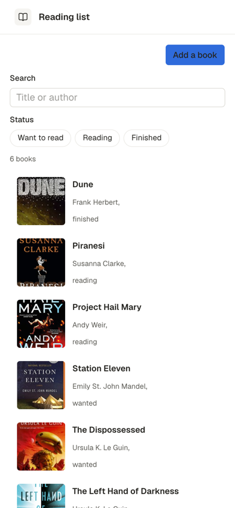
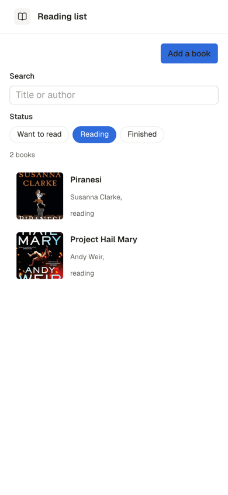
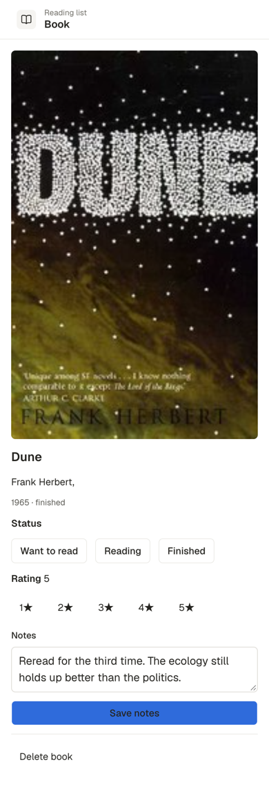
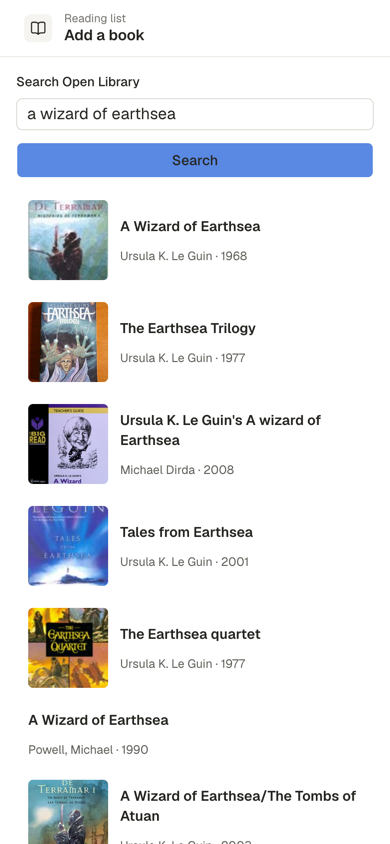
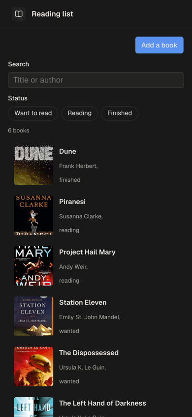
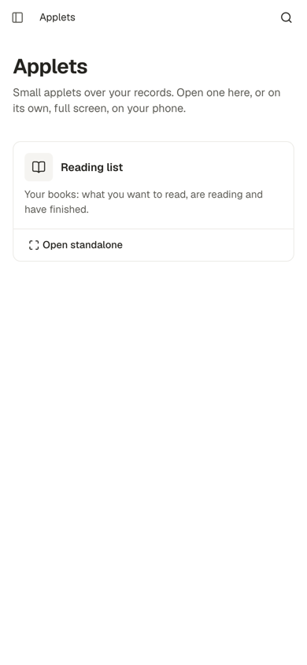
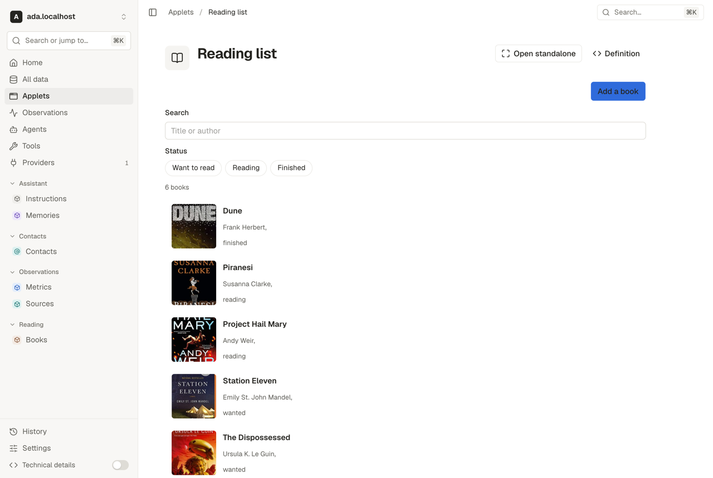

# Plan: applets as A2UI screens the substrate serves

Status: proof of concept, 2026-11-08. A plan, not a contract. It follows
[proposal A](https://github.com/geoah/substrate/pull/532) and
[proposal B](https://github.com/geoah/substrate/pull/533) and takes neither
renderer: an applet is a record, its screens are [A2UI](https://a2ui.org) v1.0
components, and the server is the A2UI "agent", a deterministic one, so a
tap is a query or a write, never a model turn.

## Why A2UI, and why server-side

The owner asks Moss for a collection and a way to use it ("my books, with a
filter by status and a search to add more"). Three things decide the shape:

- **Moss writes it.** A2UI is a closed catalog of eighteen components and
  fourteen functions with no code, built to be written by a model. What an
  agent writes is data the substrate validates against the catalog and the
  kinds before it lands, so a mistake is a `path: message` problem on the
  write, not a broken page.
- **It runs everywhere the owner is.** A2UI has renderers for the web and,
  in alpha, SwiftUI, Compose and Flutter. The console draws it with its own
  components; the native applets can later draw the same messages.
- **It may be opened standalone, and one day shared.** When the server runs
  the applet, a client holds no query API: it draws what the server sends and
  reports a named action with its context. That is the property a public
  share needs (see [What comes next](#what-comes-next)).

A2UI alone is not an applet: it has no stored screens, no navigation, no
backend binding and no pagination. Those are the substrate's half, and the
applet record says them as data: **sources** (queries whose results land in
the data model), **actions** (named steps an A2UI button event runs) and
**screens**.

## The model

One seeded package, `substrate.reamde.dev/applets`, outside core, with one kind
and one host function:

- **`substrate.reamde.dev/applets/applet`**: `name`, `description`, `icon`,
  `start`, `state`, `sources`, `actions`, `screens`. `internal`, so an
  agent's glob never reaches it; Moss's `designer` names it in its writes.
  The engine checks every write of one (`internal/applet`, `Check`) against
  the A2UI catalog and the repository's kinds, and refuses a broken one with
  a problem per path.
- **`substrate.reamde.dev/applets/preview`**: the designer's way to see what it
  built: the screen's component tree with its bindings resolved against
  live records, and every binding that resolved to nothing.

The runtime (`internal/applet`) is a function of the record, the state the
renderer holds and the repository, reached through the request's dataset,
so it reads and writes exactly what the caller's token may. Two routes:

```
POST /api/v1/substrate.reamde.dev/applets/applet/{id}/render   AppletRenderInput -> AppletFrame
POST /api/v1/substrate.reamde.dev/applets/applet/{id}/act      AppletActInput    -> AppletFrame
```

The wire is `internal/substrate/applets.go`. A frame carries the A2UI messages
and the host's part: the state, the screen's title, the kinds whose changes
re-render it, the `/ui` paths whose edits re-render it, a notice, and the
question an action waits on. The server keeps no session: the renderer
sends its state with every call.

The console draws an applet in the shell at `/applets/{id}` and standalone, with
no console chrome, at `/a/{id}`. All its applets are listed at `/applets`.

Images an applet names on another host (a book's cover) come through the
server's image proxy, `GET /api/v1/images?url=<https address>`
(`internal/api/images.go`): the console fetches each with its token and
draws it from a blob URL, so the image's host never learns who is looking
and the console's `img-src` stays its own origin. The proxy dials public
addresses alone (egress's confined client, every redirect included),
serves PNG, JPEG, GIF, WebP and AVIF and never SVG, and bounds an image at
8 MiB. It hides the viewer and nothing more: an image URL an applet builds
from a record's values still carries them to the host it names, so a host
policy is owed before anyone but the owner and their assistant writes an
applet.

## The applet record

A worked example, the books applet Moss builds in the demo (the owner's
authority is `ada.example.com`):

```yaml
kind: substrate.reamde.dev/applets/applet
metadata:
  id: books
data:
  properties:
    name: Books
    description: What I'm reading, what's next, and a search to add more.
    icon: book-open
    start: library
    state:
      status: []
      q: ""
    sources:
      books:
        kind: ada.example.com/library/book
        where:
          status:
            in:
              "@path": /ui/status
        search:
          "@path": /ui/q
        orderBy: title
        expand: [author]
      book:
        kind: ada.example.com/library/book
        id:
          "@path": /params/id
        expand: [author]
    actions:
      open:
        - op: navigate
          screen: book
          params:
            id:
              "@path": /context/id
      finish:
        - op: patch
          kind: ada.example.com/library/book
          id:
            "@path": /params/id
          properties:
            status: read
            finishedAt:
              "@now": date
        - op: notify
          text: Marked as read
    screens:
      library:
        title: Library
        sources: [books]
        refreshOn: [/ui/status, /ui/q]
        components:
          - id: root
            component: Column
            children: [search, status, list]
          - id: search
            component: TextField
            label: Search
            value:
              "@path": /ui/q
          - id: status
            component: ChoicePicker
            variant: multipleSelection
            displayStyle: chips
            value:
              "@path": /ui/status
            options:
              - {label: Reading, value: reading}
              - {label: Want to read, value: want}
              - {label: Read, value: read}
          - id: list
            component: List
            children:
              path: /data/books
              componentId: row
          - id: row
            component: Button
            variant: borderless
            child: rowText
            action:
              event:
                name: open
                context:
                  id:
                    "@path": id
          - id: rowText
            component: Text
            text:
              "@call": formatString
              args:
                value: "**${properties/title}** · ${properties/author/title}"
      book:
        title: Book
        sources: [book]
        components: [...]
```

### `start`, `state`

`start` names the first screen. `state` is the initial `/ui`: the values the
applet's inputs bind to before the owner touches them.

### The data model a screen binds to

Components bind with A2UI's own `{"@path": ...}` (v1.0 spelling; v0.9's
`{"path": ...}` is refused with a note). The runtime fills:

| Path | Holds |
| --- | --- |
| `/applet` | `id`, `name`, `screen`, `title` |
| `/ui` | the UI state; every input binds under it, two ways |
| `/params` | the screen's params, set by the `navigate` that opened it |
| `/data/<source>` | a list source: an array of records; a one-record source: the record, or null |
| `/counts/<source>` | how many records a list source answered |

A record in the data model is `{id, kind, ref, title, version, properties}`,
`ref` being `<kind>/<id>`. A reference property a source names under
`expand` holds the record it points at in the same shape; any other holds
the stored `{ref}`. Inside a list template, paths are relative to the item:
`properties/title`, `properties/author/title`, `id`.

### `sources`

Each is one read, run when a screen that names it renders:

| Key | Is |
| --- | --- |
| `kind` | the kind, in full |
| `id` | one record by id: the source is that record, or null |
| `where` | one condition per property, the records filter grammar (`eq`, `in`, `prefix`, `match`, `gt`, `gte`, `lt`, `lte`, `contains`, `exists`), or a bare value for `eq` |
| `search` | full-text search over the records' index |
| `orderBy` | `property` or `property:desc`, or a list of them |
| `first` | how many, default 100, at most 500 |
| `expand` | reference properties whose records come along |

A value anywhere in a source may be a binding. **A condition whose binding
resolves to nothing (null, `""` or `[]`) is dropped**, so an empty filter is
"all".

### Bindings the server resolves

In sources and actions, never in components, a binding is A2UI's own
`{"@path": ...}` read against the server's side of the model:

| Path | Is | Where |
| --- | --- | --- |
| `/ui/...`, `/params/...` | the renderer's state | sources and actions |
| `/context/<key>` | the tapped button's `action.event.context` value | actions |
| `/results/<as>/...` | what an earlier step named with `as` answered | actions |

`{"@now": "date"}` or `{"@now": "datetime"}` is today or this instant (UTC),
`{"@call": "formatString", "args": {"value": "Added ${/context/title}"}}`
fills a notice or a question, and `{"@call": "addDays", "args": {"value":
<a date or an instant>, "days": <a whole number>}}` moves a date (a date stays
a date) for a window's far end or a due date. A2UI's catalog has no date
arithmetic, so it is the server's alone, never a component's. Anything else
is a literal; objects and lists resolve inside.

A source whose `where` bounds `at` on both ends over a kind on the timeline
is the [window read](../api.md#the-window-read): a repeating record's
occurrences inside the window arrive beside the stored rows, each with
`computed: true` and `series {id, ref}`, the repeating record a step reads
or opens; the occurrence itself is never written. Something done again
some days after the last time is no calendar rule but a `dueAt` the done
button moves on with `addDays`, and its due list is a source over `dueAt`
bounded above alone, so what is overdue stays on it. A kind's timeline columns (`at`, `endsAt`, `dueAt`) come from
its `temporal` binding, not its properties, and the check accepts them.

### `actions`

A Button's `action: {event: {name, context}}` names one; an action is a list
of steps run in order, stopping at the first refusal:

| `op` | Does | Takes |
| --- | --- | --- |
| `create` | creates a record under a minted id | `kind`, `properties` |
| `patch` | changes properties (a `state` property moves along a declared transition) | `kind`, `id`, `properties` |
| `delete` | deletes a record | `kind`, `id` |
| `ensure` | finds the first record matching `where`, or creates it from `properties` | `kind`, `where`, `properties` |
| `read` | reads one record into a `/ui` path, or the part `pick` names, so an edit screen's inputs open on what is saved | `kind`, `id`, `pick`, `into` |
| `call` | calls a function; `into` puts its output, or the part `pick` names, at a `/ui` path | `function`, `input`, `pick`, `into` |
| `navigate` | shows another screen | `screen`, `params` |
| `set` | sets `/ui` paths | `values`: `{"/ui/form": {}}` |
| `notify` | a line the host shows once | `text` |

Every step may carry `as` (a name its result is kept under, at
`/results/<as>`). An action may ask one question, `confirm` on its first step
that needs one; it is answered before any step runs, so it reads `/ui`,
`/params` and `/context`, never `/results`, and it is a courtesy, not an
authorization. A `patch` leaves out every property whose binding reads a
path the state does not hold: an edit that never loaded is not the owner
clearing a value. An action is not replayed (see [Retries](#retries)): a
retried tap runs its steps again, so a retried create makes a second record,
and an action that failed halfway keeps what its earlier steps wrote. A
record result is the data-model shape above, so
`{"@path": "/results/author/ref"}` is a reference value, the record path.

### `screens`

| Key | Is |
| --- | --- |
| `title` | the screen's title in the host's header |
| `sources` | the sources it reads |
| `refreshOn` | `/ui` paths whose edits re-render it (a filter, a search box) |
| `init` | `read` and `set` steps run each time the screen is entered, by a tap, a link or a step back: a detail screen loads its edits here, keyed by its params |
| `components` | A2UI v1.0 basic catalog components, a flat list with one `root` |

The host gives every screen a header with its title and a back button, so a
screen draws neither. Live changes to the kinds its sources read re-render it.

## Moss

Moss hands an applet to its **designer**, a sub-agent with `query`, `write`
(naming `substrate.reamde.dev/applets/applet` alone) and `preview`. The
designer reads the kinds, writes the applet, previews every screen, fixes what
preview flags and answers with the applet's address. A missing collection is
the architect's first.

An assistant at the [MCP door](../mcp.md) builds applets the same way: the
`applets` tool serves the guide (`internal/applet/guide.md`, which a test
holds to every op and root the check admits) and previews a stored applet or
a draft through `POST …/applets/applet/{id}/preview`, and `write` writes it.
No app scope writes an applet (decision 0243): it runs under its viewer's
token, and an image URL built from a record's values carries them to its
host.

## Display values

A record in the data model carries `display` beside `properties`: each
property as a person reads it, built from the kind's declaration. An enum or
a state shows its value's label, else the value made readable
(`inProgress` reads "In progress"); a list is its items joined with ", "; an
expanded reference is its record's title, and one not expanded shows
nothing; a bool is "Yes" or "No". A property with nothing to show has no
display value, so a placeholder over it reads "". This is what A2UI's
catalog cannot do without a join, a lookup or a condition, and it covers
what the designer asked for in the first live runs.

## Retries

An action is not replayed. Its steps run without the request's idempotency
key: one key over two creates would collide, and a patch or a delete
consults no key, so a key on every step would promise a replay only some
steps keep. A retried tap runs the action again, and an action refused
halfway keeps what its earlier steps wrote; the refusal names the action
and the step. Replay protection, with versions carried into edits, is
[#1265](https://github.com/geoah/substrate/issues/1265).

## The demo, as Moss built it

On a fresh substrate, one chat message ("keep track of the books I read and
their authors [...] an app to manage it on my phone, where I can filter by
status, search, and add books by searching online, picking a result") had
the architect declare `reading/book` and the designer write a three-screen
applet in about forty seconds, its book screen loading its edits through
`init`. One follow-up asked for plain author names, no lone star for an
unrated book and the rating stars on one row; the designer did what A2UI
allows and said plainly what it does not: no join for a list, no visibility
on a condition, no label for an enum value (see [what comes next](#what-comes-next)).
Earlier runs on this branch drove the checks this plan describes: a count
written as `${...}` outside `formatString`, an edit that opened empty, a
book screen opened from a bookmark. The book search is
[openlibrary.yaml](applets/openlibrary.yaml), applied by hand. Screens at a
phone's width, standalone at `/a/books`:

| The list | Filtered to Reading | A book, opened from a bookmark |
| --- | --- | --- |
|  |  |  |

| Adding from Open Library | Dark | The launcher |
| --- | --- | --- |
|  |  |  |

In the console's shell, at `/applets/books`:



## What this proves, and what it does not

Proves: an agent writes a usable multi-screen applet over typed records from
one request; the server validates it against the official catalog; the
console draws A2UI with its own components; the same record opens in the
shell and standalone.

Does not: native rendering, scoped tokens for a standalone applet, public
shares, conditional visibility (A2UI v1.0 has none), pagination past one
read, offline use.

## What comes next

- **What the designer asked for.** Display values (above) cover labels and
  lists; a substrate catalog extension adds a `when` on any component, for
  the cases a value alone does not.

- **A standalone applet holds its own token.** `/a/{id}` asks the 0194
  approval for the kinds the applet's sources and actions name, so a phone with
  the applet holds that and nothing else.
- **Shares.** A `share` record names an applet, a mode (read, submit, edit), a
  projection per kind and the actions it admits; the server runs the applet
  under it for anyone with the link. Writes land as the share's actor,
  gated by default.
- **Native.** The SwiftUI renderer draws the same frames.
- **Moss's chat cards.** A reply that shows records is an A2UI surface Moss
  writes inline, and "keep this" makes it an applet.
